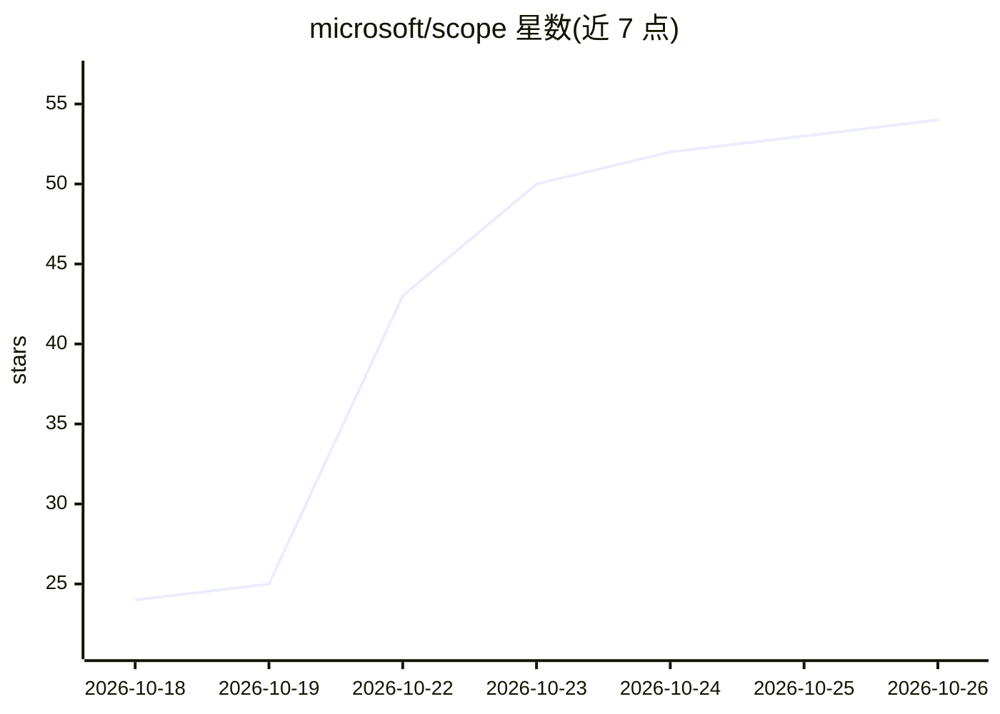

# microsoft/scope

⭐ 54 · TypeScript · MIT · 推送 2026-10-23 · [GitHub](https://github.com/microsoft/scope) · [官网](https://microsoft.github.io/scope/) · 组织维护

**微软开源的 AI agent 体验评估平台（研究预览）**

微软维护的开源 agentic 体验评估平台（Research preview）：用于评估 AI agent 如何使用产品、执行真实任务并响应反馈。支持以可复用标准定义成功判据、实时跟踪每次运行，并通过 Portal 或 CLI 检视每条结果背后的证据。采用 MIT 许可证；README 未包含具体安装命令，安装与工作流说明位于官方文档网站（含 Getting started 与 Local development 指引），另提供贡献者指南与支持/漏洞报告渠道。

## 筛选速览

| 维度 | 判定 | 备注 |
|---|---|---|
| AI 角色 | `ai-ecosystem` | LLM/agent 周边工具 |
| 许可风险 | `permissive` | MIT |
| 部署形态 | `None` |  |
| 模型依赖 | — | README 未给出锁定关系 |
| 硬件要求 | — | 无带数字的原话,不猜 |
| 安装摩擦 | `low` | 无编译、无系统依赖或容器化 |
| 成熟度 | `idea` | |

## 能力要点

- 以可复用标准定义 agent 成功判据
- 实时跟踪每次运行并通过 Portal/CLI 检视结果证据
- MIT 许可开源，附官方文档站

## 适用场景

- 评估 AI agent 在产品中的任务执行表现
- 定义可复用的评估标准并跟踪 agent 运行
- 审阅评估结果背后的证据

## 场景标签

`模型评测` · 领域:评测与运维

## 证据(README 行号)

> L3:  An open-source agentic experience evaluation platform.
> L5:  Evaluate how AI agents use your product, approach real tasks, and respond to feedback.

## 星数曲线

2026-10-18 24 → 2026-10-26 54（+30）

---
*卡片 v1 · prompt 1.4 · 生成 2026-10-24 · 置信度 mid · 依据 README sha `a96ade9fe2d8` · [字段定义](../../DATASET.md)*
