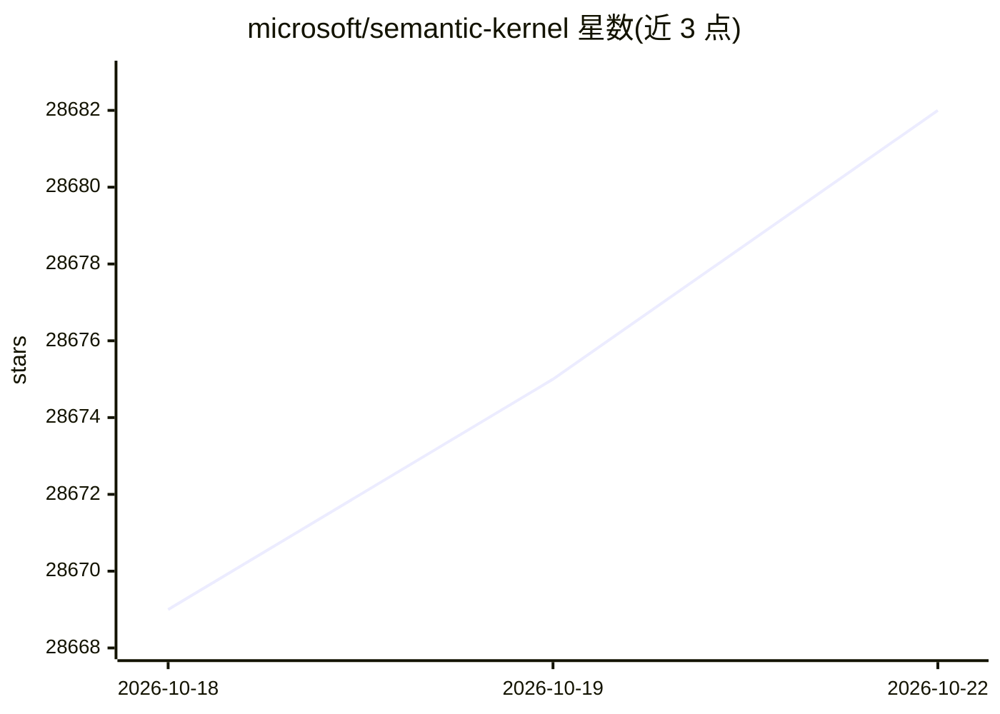

# microsoft/semantic-kernel

⭐ 28,690 · C# · MIT · 推送 2026-10-22 · [GitHub](https://github.com/microsoft/semantic-kernel) · [官网](https://aka.ms/semantic-kernel) · 组织维护

**为开发者提供构建 AI 智能体与多智能体系统的 SDK**

Semantic Kernel 是一个模型无关的 SDK，提供 Python、.NET、Java 三语言包，用于构建、编排和部署 AI agent 与多智能体系统。关键机制包括：插件/工具扩展（原生函数、prompt 模板、OpenAPI、MCP）、多智能体编排、向量数据库集成、多模态输入处理与本地部署支持。README 顶部声明该项目已由 Microsoft Agent Framework 接替，MAF 1.0 已发布并提供迁移指南。

## 筛选速览

| 维度 | 判定 | 备注 |
|---|---|---|
| AI 角色 | `ai-native` | 本体是模型或模型工具 |
| 许可风险 | `permissive` | MIT |
| 部署形态 | `library` | 以包/库形式分发 |
| 模型依赖 | local-ok | 支持本地模型 |
| 硬件要求 | — | 无带数字的原话,不猜 |
| 安装摩擦 | `medium` | 含编译或系统依赖之一 |
| 成熟度 | — | 结构信号不足 |

## 动量与使用信号

- 维护:`active` — 距上次 push 1.7 天,年发版 39,404 位贡献者
- 涨星:近 1 天 **+2**(自 20261016 起算)
- 安装:pypi 包 `semantic-kernel` 月下载 300,767
- 平台:WINDOWS / MACOS / LINUX · 协议:MCP / OLLAMA

## 能力要点

- 模型无关 SDK，内置接入 OpenAI、Azure OpenAI、Hugging Face、NVidia 等
- 提供 Python / .NET / Java 三语言包
- 插件扩展支持原生函数、prompt 模板、OpenAPI、MCP
- 支持 Ollama、LMStudio、ONNX 本地运行

## 适用场景

- 在应用中接入 LLM 构建聊天助手
- 编排多个协作 agent 处理复杂工作流
- 通过插件/工具扩展让 agent 调用自有能力
- 企业环境中构建可观测、安全的 agent 系统

## 场景标签

`Agent 框架` `多智能体` · 领域:Agent 开发

## 证据(README 行号)

> L17: Semantic Kernel is a model-agnostic SDK that empowers developers to build, orchestrate, and deploy AI agents and mu
> L4: > Semantic Kernel is now Microsoft Agent Framework! Microsoft Agent Framework (MAF) is the enterprise‑ready successo

## 星数曲线

2026-10-18 28,669 → 2026-10-22 28,682（+13）

---
*卡片 v1 · prompt 1.4 · 生成 2026-10-18 · 置信度 high · 依据 README sha `4f0e02add554` · [字段定义](../../DATASET.md)*
