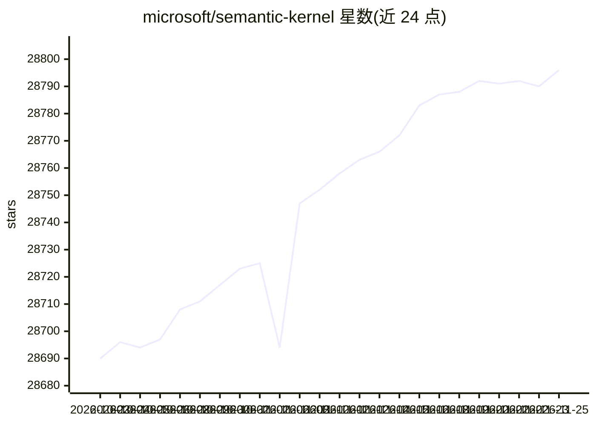

# microsoft/semantic-kernel

⭐ 28,796 · C# · MIT · 推送 2026-11-23 · [GitHub](https://github.com/microsoft/semantic-kernel) · [官网](https://aka.ms/semantic-kernel) · 组织维护

**面向开发者的 LLM Agent 编排 SDK（Python/.NET/Java）**

Semantic Kernel 是微软维护的模型无关 SDK，用于构建、编排和部署 AI Agent 与多 Agent 系统。提供 Agent 框架、多 Agent 协作编排、插件生态（原生函数、提示模板、OpenAPI、MCP）、向量数据库集成与结构化业务流程建模（Process Framework）。支持 OpenAI、Azure OpenAI、Hugging Face 等云端模型及 Ollama、LMStudio、ONNX 本地部署，多语言发行于 Python、.NET 与 Java。README 注明其继任者为 Microsoft Agent Framework。

## 筛选速览

| 维度 | 判定 | 备注 |
|---|---|---|
| AI 角色 | `ai-ecosystem` | LLM/agent 周边工具 |
| 许可风险 | `permissive` | MIT |
| 部署形态 | `library` | 以包/库形式分发 |
| 模型依赖 | local-ok | 支持本地模型 |
| 硬件要求 | — | 无带数字的原话,不猜 |
| 安装摩擦 | `medium` | 含编译或系统依赖之一 |
| 成熟度 | — | 结构信号不足 |

## 动量与使用信号

- 维护:`active` — 距上次 push 1.7 天,年发版 39,404 位贡献者
- 涨星:近 1 天 **+2**(自 20261016 起算)
- 安装:pypi 包 `semantic-kernel` 月下载 300,767
- 平台:WINDOWS / MACOS / LINUX · 协议:MCP / OLLAMA

## 能力要点

- 模型无关 SDK，内置 OpenAI、Azure OpenAI、Hugging Face、NVIDIA 等连接器
- Agent 框架支持工具/插件、记忆与规划能力
- 插件生态：原生函数、提示模板、OpenAPI 规范、MCP
- 支持 Ollama、LMStudio、ONNX 本地部署与多模态输入

## 适用场景

- 在 Python/.NET/Java 应用中接入 LLM 构建 chatbot
- 编排多个专业化 Agent 协作完成复杂工作流
- 通过插件与 MCP 扩展 Agent 的工具能力
- 企业环境中构建可观测、可扩展的 Agent 系统

## 场景标签

`Agent 框架` `多智能体` · 领域:Agent 开发

## 证据(README 行号)

> L17: Semantic Kernel is a model-agnostic SDK that empowers developers to build, orchestrate, and deploy AI agents and mu
> L29: - **Agent Framework**: Build modular AI agents with access to tools/plugins, memory, and planning capabilities
> L4: > Semantic Kernel is now Microsoft Agent Framework! Microsoft Agent Framework (MAF) is the enterprise‑ready successo

## 星数曲线

2026-10-23 28,690 → 2026-11-25 28,796（+106）

---
*卡片 v1 · prompt 1.4 · 生成 2026-11-22 · 置信度 high · 依据 README sha `f602b39cb1e8` · [字段定义](../../DATASET.md)*
