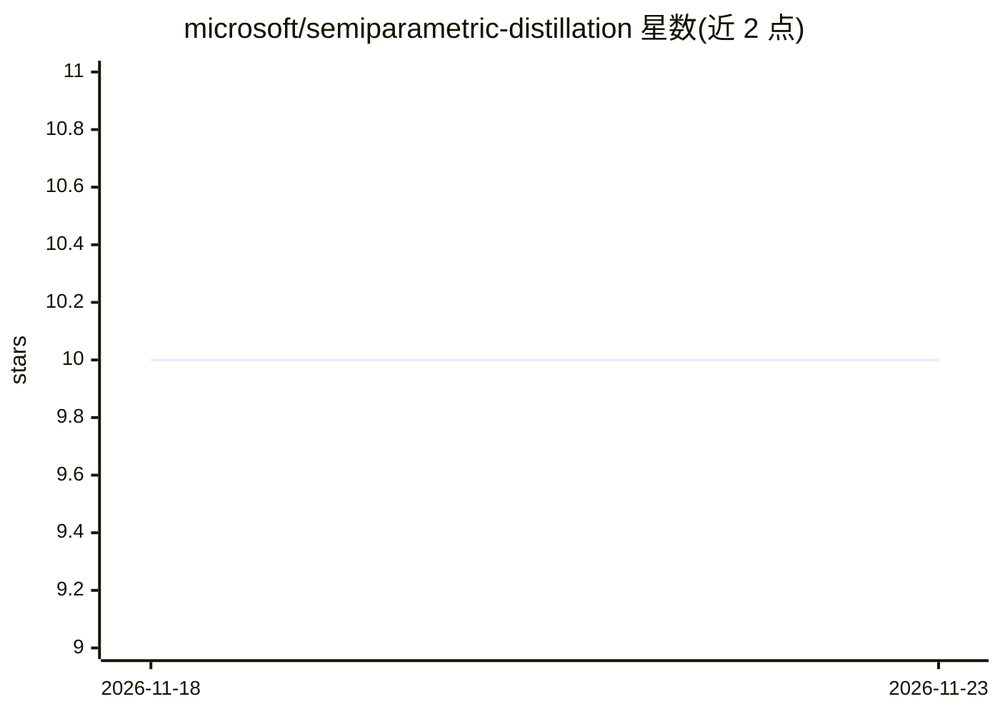

# microsoft/semiparametric-distillation

⭐ 10 · Python · MIT · 推送 2026-11-17 · [GitHub](https://github.com/microsoft/semiparametric-distillation) · 组织维护

**复现 ICRL 2021 半参数推断知识蒸馏论文实验的代码库**

提供《Knowledge Distillation as Semiparametric Inference》（Dao 等，ICLR 2021）论文实验的复现代码，训练流程基于 PyTorch 与 PyTorch-Lightning 组织，配置管理使用 Hydra，含 ResNet18 在 CIFAR10 上的训练脚本与 CNN5 学生模型的蒸馏训练脚本（KDOrthoLoss、温度、梯度裁剪等参数可配置）。可选支持 Ray 分布式训练与 Wandb 日志。要求 Python >= 3.7、PyTorch >= 1.7，依赖清单见 requirements.txt。

## 筛选速览

| 维度 | 判定 | 备注 |
|---|---|---|
| AI 角色 | `ai-native` | 本体是模型或模型工具 |
| 许可风险 | `permissive` | MIT |
| 部署形态 | `None` |  |
| 模型依赖 | — | README 未给出锁定关系 |
| 硬件要求 | — | 无带数字的原话,不猜 |
| 安装摩擦 | `low` | 无编译、无系统依赖或容器化 |
| 成熟度 | — | 结构信号不足 |

## 能力要点

- 复现 ICLR 2021 论文的蒸馏实验流程
- 训练脚本支持 batch size、学习率、蒸馏损失、温度等参数配置
- 可选 Ray 分布式训练与 Wandb 日志

## 适用场景

- 复现论文中的知识蒸馏实验结果
- 在 CIFAR10 上训练教师模型并蒸馏出 CNN5 学生模型
- 作为 Hydra + PyTorch-Lightning 组织实验代码的参考

## 场景标签

`微调` `模型训练` · 领域:训练与推理

## 证据(README 行号)

> L3: This code replicates the experiments of
> L38: To train a ResNet18 on CIFAR10, and save model to disk:
> L43: To train a CNN5 student:

## 星数曲线

2026-11-18 10 → 2026-11-23 10（+0）

---
*卡片 v1 · prompt 1.4 · 生成 2026-11-19 · 置信度 high · 依据 README sha `1d1fab5b1184` · [字段定义](../../DATASET.md)*
