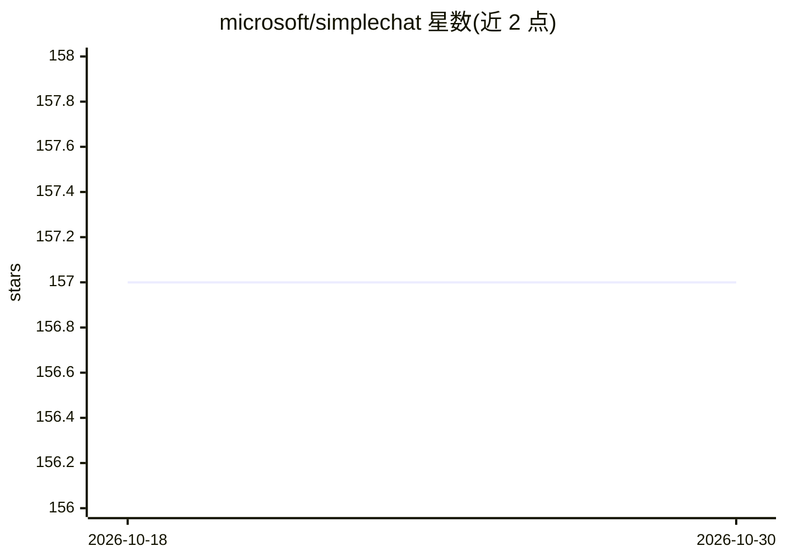

# microsoft/simplechat

⭐ 157 · Python · NOASSERTION · 推送 2026-10-29 · [GitHub](https://github.com/microsoft/simplechat) · 组织维护

**面向企业的安全 RAG 对话平台：基于 Azure 的文档/音视频 AI 问答**

微软开源的 Web 端 AI 对话平台，核心为基于 Azure OpenAI 的 RAG：文档经 Azure AI Document Intelligence 处理并按内容类型分块，经 Azure OpenAI Embeddings 向量化后索引至 Azure AI Search，支持语义+关键词混合检索。提供个人与群组工作区、Entra ID 认证与 RBAC、会话归档等治理能力；可选启用 DALL-E 图像生成、视频/音频 RAG、内容安全审查、文档分类与 Bing 搜索。仅限 Azure 环境部署（含商业云与政府云），通过 azd/容器或原生 Python 方式部署至 Azure App Service。

## 筛选速览

| 维度 | 判定 | 备注 |
|---|---|---|
| AI 角色 | `ai-native` | 本体是模型或模型工具 |
| 许可风险 | `none` | NOASSERTION |
| 部署形态 | `self-host` | docker 或自建部署 |
| 模型依赖 | locked-api |  |
| 硬件要求 | — | 无带数字的原话,不猜 |
| 安装摩擦 | `low` | 无编译、无系统依赖或容器化 |
| 成熟度 | — | 结构信号不足 |

## 能力要点

- Azure AI Search 混合检索（语义+关键词）驱动的 RAG 对话
- 个人/群组工作区文档管理与 RBAC 访问控制
- 可选内容安全审查、会话归档合规、DALL-E 图像生成、视频/音频 RAG
- 支持 Azure Commercial 与 Azure Government 云部署

## 适用场景

- 在组织内私有数据上构建带权限控制的 AI 问答
- 团队共享文档并基于群组知识库协作对话
- 满足会话归档与内容合规审计要求的企业 AI 使用场景

## 场景标签

`聊天机器人` `RAG` `文档问答` · 领域:对话与助手

## 证据(README 行号)

> L5: The **Simple Chat Application** is a comprehensive, web-based platform designed to facilitate secure and context-awa
> L9: The application utilizes **Azure Cosmos DB** for storing conversations, metadata, and settings, and is secured using
> L250: - **Chat with AI**: Interact with an AI model based on Azure OpenAI’s GPT and Thinking models.

## 星数曲线

2026-10-18 157 → 2026-10-30 157（+0）

---
*卡片 v1 · prompt 1.4 · 生成 2026-10-22 · 置信度 mid · 依据 README sha `e0240d382131` · [字段定义](../../DATASET.md)*
