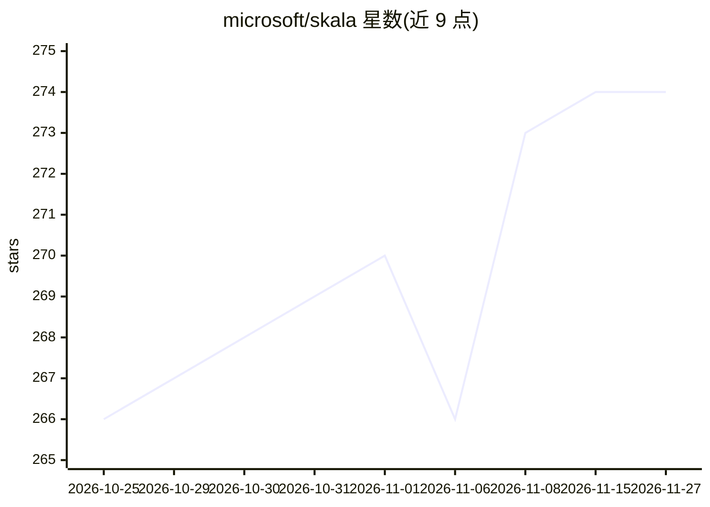

# microsoft/skala

⭐ 274 · Python · MIT · 推送 2026-11-25 · [GitHub](https://github.com/microsoft/skala) · [官网](https://aka.ms/dft) · 组织维护

**基于深度学习的 DFT 交换相关泛函，供量子化学计算使用**

Microsoft Research AI for Science 开发的神经网络交换相关泛函，从电子密度特征预测交换相关能量，用于密度泛函理论（DFT）计算。仓库包含五个组件：已发布的 skala Python 包（加载已发布 checkpoint 并通过 PySCF、GPU4PySCF、ASE 调用）、可训练模型定义、GauXC 集成、基准测试工具与文档站点。支持 Linux 与 Apple Silicon macOS，GPU 加速下 SCF 迭代成本接近半局域泛函；模型约 38.5 万参数，当前推荐版本为 skala-1.1。

## 筛选速览

| 维度 | 判定 | 备注 |
|---|---|---|
| AI 角色 | `ai-native` | 本体是模型或模型工具 |
| 许可风险 | `permissive` | MIT |
| 部署形态 | `library` | 以包/库形式分发 |
| 模型依赖 | — | README 未给出锁定关系 |
| 硬件要求 | `cpu-ok` | |
| 安装摩擦 | `medium` | 含编译或系统依赖之一 |
| 成熟度 | — | 结构信号不足 |

## 能力要点

- 神经网络泛函通过 PySCF/GPU4PySCF/ASE 运行 SCF 与几何优化
- 提供 C++/Fortran/C 编译示例（libtorch/FTorch/GauXC）
- 官方 .fun 模型加载时自动校验 SHA-256 完整性
- 提供 pixi 锁定环境（CUDA 12/13 与 CPU）

## 适用场景

- 主族热化学、动力学与非共价相互作用 DFT 计算
- 通过 GPU4PySCF 加速含数百原子体系的 SCF 迭代
- 用 ASE 计算器做能量、力与几何优化工作流
- 通过 GauXC 集成到第三方 DFT 代码

## 场景标签

`科研工具` · 领域:学习与行业

## 证据(README 行号)

> L8: Skala is a neural network-based exchange-correlation functional for density functional theory (DFT), developed by Mi
> L20: 1. `skala/` is the only published Python package. It contains the runtime needed to load released checkpoints and u

## 星数曲线

2026-10-25 266 → 2026-11-27 274（+8）

---
*卡片 v1 · prompt 1.4 · 生成 2026-11-25 · 置信度 high · 依据 README sha `4eead0e95fd0` · [字段定义](../../DATASET.md)*
