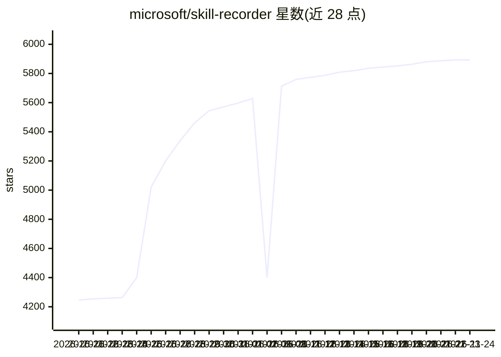

# microsoft/skill-recorder

⭐ 5,893 · TypeScript · MIT · 推送 2026-11-19 · [GitHub](https://github.com/microsoft/skill-recorder) · 组织维护

**录制屏幕操作，AI 重建为可复用的 agent 技能**

Electron 桌面应用，捕获屏幕点击、窗口切换、网页访问、可选终端输出与语音旁白，再通过 GitHub Copilot CLI 将会话重建为意图加有序步骤，并生成 SKILL.md 形式的 Skill 或定时/触发式 Automation，供 Copilot Scout、Copilot Cowork、Copilot Studio 等 agent 复用；生成物优先使用 agent 原生工具而非回放 UI 点击。支持导入本地 MP4/WebM 录像，音频用本地 Whisper 模型转录。macOS 为主要目标平台，Windows 11 x64/ARM64 也支持；安装采用源码发布方式，本机构建 pinned Node.js 运行时。

## 筛选速览

| 维度 | 判定 | 备注 |
|---|---|---|
| AI 角色 | `ai-native` | 本体是模型或模型工具 |
| 许可风险 | `permissive` | MIT |
| 部署形态 | `desktop` | 安装包/桌面程序 |
| 模型依赖 | — | README 未给出锁定关系 |
| 硬件要求 | — | 无带数字的原话,不猜 |
| 安装摩擦 | `medium` | 含编译或系统依赖之一 |
| 成熟度 | — | 结构信号不足 |

## 能力要点

- 录屏→意图+有序步骤→Skill/Automation 的重建流水线
- 可选录制的终端会话与语音旁白一并捕获
- 导入 MP4/WebM 录像，Whisper 本地转录，无需单独安装 FFmpeg
- 生成的技能优先使用 agent 原生工具（如 gh CLI、web_fetch）

## 适用场景

- 把一次性完成的网页表单流程教给 agent 批量复用
- 将 Teams 演示录像导入并转成可执行的技能
- 为 Copilot Cowork/Copilot Studio 准备定时自动化

## 场景标签

`工作流自动化` · 领域:效率与自动化

## 证据(README 行号)

> L14: the **GitHub Copilot CLI** to reconstruct *what you actually did* as a clear **intent plus
> L18: - a **Skill**: a `SKILL.md` procedure an agent runs on demand, or
> L113: **Copilot access**, or a supported model provider's API key; the Copilot CLI ships

## 星数曲线

2026-10-21 4,246 → 2026-11-24 5,893（+1,647）

---
*卡片 v1 · prompt 1.4 · 生成 2026-11-22 · 置信度 mid · 依据 README sha `534d6653dfbe` · [字段定义](../../DATASET.md)*
