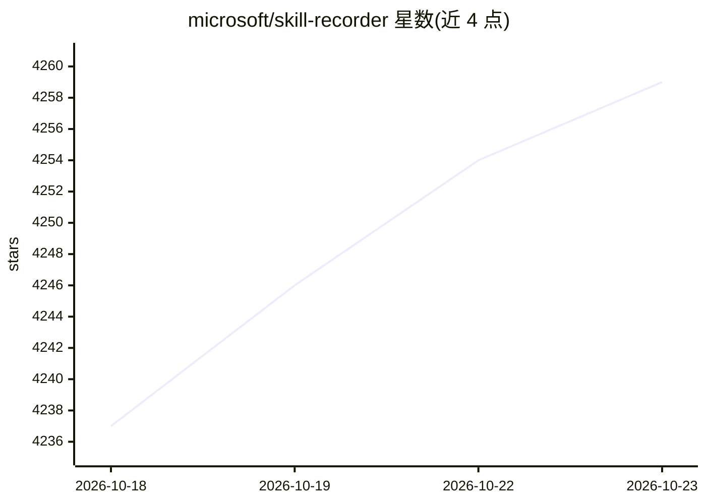

# microsoft/skill-recorder

⭐ 4,259 · TypeScript · MIT · 推送 2026-10-18 · [GitHub](https://github.com/microsoft/skill-recorder) · 组织维护

**录制屏幕操作并生成可复用 AI Skill/Automation 的桌面应用**

微软开源的 Electron 桌面应用（macOS 为主，支持 Windows 11 x64/ARM64 与 Ubuntu）：录制屏幕上的点击、窗口切换、浏览器 URL、剪贴板预览、可选语音叙述与受控终端命令，调用 GitHub Copilot CLI（随附、固定 1.0.78 版）把操作过程重构为意图+有序步骤，再生成 SKILL.md 格式的 Skill 或定时 Automation，供 Copilot Studio、Copilot Cowork、Scout 等 agent 使用。需 GitHub 账号与 Copilot 订阅；录制在本地，Analyze 时数据发送至 GitHub 云端；叙述转写用设备端 Whisper（首次约 252MB 模型下载）。以源码发行方式一条命令安装。

## 筛选速览

| 维度 | 判定 | 备注 |
|---|---|---|
| AI 角色 | `ai-ecosystem` | LLM/agent 周边工具 |
| 许可风险 | `permissive` | MIT |
| 部署形态 | `desktop` | 安装包/桌面程序 |
| 模型依赖 | — | README 未给出锁定关系 |
| 硬件要求 | — | 无带数字的原话,不猜 |
| 安装摩擦 | `low` | 无编译、无系统依赖或容器化 |
| 成熟度 | — | 结构信号不足 |

## 能力要点

- 录制屏幕会话，Copilot 重构为意图+有序步骤，生成 SKILL.md Skill 或定时 Automation
- 生成的 Skill 优先使用 agent 原生工具（gh CLI、web_fetch）并从单次示例泛化
- 本地录制/存储/转写，仅 Analyze 时上送事件时间线与截取图像至 GitHub 云端
- 设备端 Whisper 转写支持 99 种语言，含终端命令/PII 扫描

## 适用场景

- 录一次任务操作，让 Copilot agent 之后可重复执行该任务
- 为 Copilot Studio / Cowork / Scout 制作可复用技能
- 把日常工作流转成定时触发的 Automation

## 场景标签

`工作流自动化` · 领域:效率与自动化

## 证据(README 行号)

> L14: the **GitHub Copilot CLI** to reconstruct *what you actually did* as a clear **intent plus
> L18: - a **Skill**: a `SKILL.md` procedure an agent runs on demand, or

## 星数曲线

2026-10-18 4,237 → 2026-10-23 4,259（+22）

---
*卡片 v1 · prompt 1.4 · 生成 2026-10-20 · 置信度 high · 依据 README sha `305e980d41df` · [字段定义](../../DATASET.md)*
