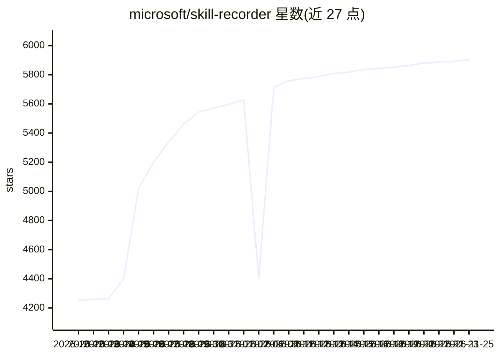

# microsoft/skill-recorder

⭐ 5,902 · TypeScript · MIT · 推送 2026-11-23 · [GitHub](https://github.com/microsoft/skill-recorder) · 组织维护

**把一次屏幕操作录制成可复用 Agent 技能的桌面工具**

Electron 桌面应用，本地捕获屏幕点击、窗口切换、页面访问与可选终端输出和语音旁白，随后通过内置的 GitHub Copilot CLI 将录制内容重建为一条意图与有序步骤清单，可生成 SKILL.md 格式的 Skill 或定时/触发式 Automation。支持导入 MP4/WebM 录像代替现场录制，音频用本地 Whisper 模型转写。macOS 为主要目标平台，Windows 11 x64/ARM64 也受支持；分析时会把帧与转写文本发送到所选 AI 供应商，录制本身在本地进行。

## 筛选速览

| 维度 | 判定 | 备注 |
|---|---|---|
| AI 角色 | `ai-native` | 本体是模型或模型工具 |
| 许可风险 | `permissive` | MIT |
| 部署形态 | `desktop` | 安装包/桌面程序 |
| 模型依赖 | — | README 未给出锁定关系 |
| 硬件要求 | — | 无带数字的原话,不猜 |
| 安装摩擦 | `medium` | 含编译或系统依赖之一 |
| 成熟度 | — | 结构信号不足 |

## 能力要点

- 录制屏幕操作后重建为 intent + 有序步骤，生成 SKILL.md 技能或定时 Automation
- 技能优先使用 agent 原生工具（如 gh CLI、web_fetch）而非回放 UI 点击
- 支持导入 MP4/WebM 录像，本地 Whisper 转写音频，无需独立 FFmpeg 安装
- 支持 GitHub Copilot 登录或自带模型 API key 两种 AI 接入方式

## 适用场景

- 把重复执行的网页/桌面操作一次性教给 agent 自动完成
- 将已有的 Teams 演示录像导入并转化为技能
- 为 Copilot Studio、Scout 等 Autopilot 制作可复用自动化流程

## 场景标签

`GUI 自动化` `工作流自动化` · 领域:效率与自动化

## 证据(README 行号)

> L14: the **GitHub Copilot CLI** to reconstruct *what you actually did* as a clear **intent plus
> L36: 3. 🧠 **Analyze.** Click Analyze and your selected AI provider reconstructs one overall intent and
> L110: Skill Recorder is published as a **source release**: one command downloads a pinned Node.js

## 星数曲线

2026-10-22 4,254 → 2026-11-25 5,902（+1,648）

---
*卡片 v1 · prompt 1.4 · 生成 2026-11-24 · 置信度 high · 依据 README sha `e4248d1ea197` · [字段定义](../../DATASET.md)*
