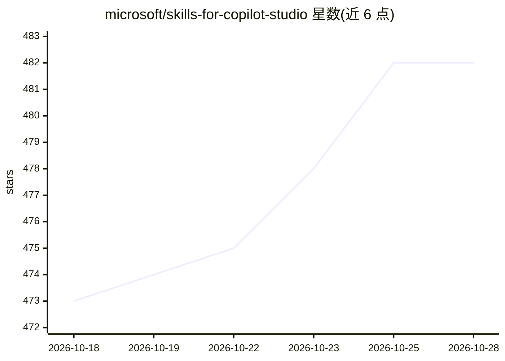

# microsoft/skills-for-copilot-studio

⭐ 483 · JavaScript · MIT · 推送 2026-10-27 · [GitHub](https://github.com/microsoft/skills-for-copilot-studio) · 组织维护

**让 AI 编码工具以 YAML 编写/管理 Copilot Studio agent 的插件**

面向 Claude Code、GitHub Copilot CLI 与 VS Code 的插件，使用户能在终端或编辑器中以 YAML 文件编写、测试与排查 Microsoft Copilot Studio STANDARD agent。提供四个子代理：云与本地文件间克隆/推送/拉取同步、YAML 创作（主题/动作/知识/触发器/变量）、发布代理的点测/批量测试与评测分析、设计指导与排障。前置要求 Node.js 18+，push/pull/clone 操作需 VS Code Copilot Studio 扩展。项目自述为实验性研究项目，schema 可能变更。

## 筛选速览

| 维度 | 判定 | 备注 |
|---|---|---|
| AI 角色 | `ai-ecosystem` | LLM/agent 周边工具 |
| 许可风险 | `permissive` | MIT |
| 部署形态 | `None` |  |
| 模型依赖 | — | README 未给出锁定关系 |
| 硬件要求 | — | 无带数字的原话,不猜 |
| 安装摩擦 | `low` | 无编译、无系统依赖或容器化 |
| 成熟度 | `idea` | |

## 能力要点

- 四个子代理：同步管理、YAML 创作、测试与评测、设计指导
- 通过 marketplace 命令、VS Code 扩展商店或本地克隆三种方式安装
- 云与本地文件间的 agent 内容克隆/推送/拉取

## 适用场景

- 用 Claude Code 或 GitHub Copilot CLI 直接编写 Copilot Studio agent 的 YAML
- 在本地与云端之间同步 agent 内容
- 对已发布 agent 执行批量测试与评测分析

## 场景标签

`模型评测` · 领域:评测与运维

## 证据(README 行号)

> L3: A plugin for Claude Code, GitHub Copilot CLI, and VS Code that enables authoring, testing, and troubleshooting Micro
> L48: The plugin provides four sub-agents, each backed by a specialized agent:

## 星数曲线

2026-10-18 473 → 2026-10-28 482（+9）

---
*卡片 v1 · prompt 1.4 · 生成 2026-10-21 · 置信度 high · 依据 README sha `2deb910455e0` · [字段定义](../../DATASET.md)*
