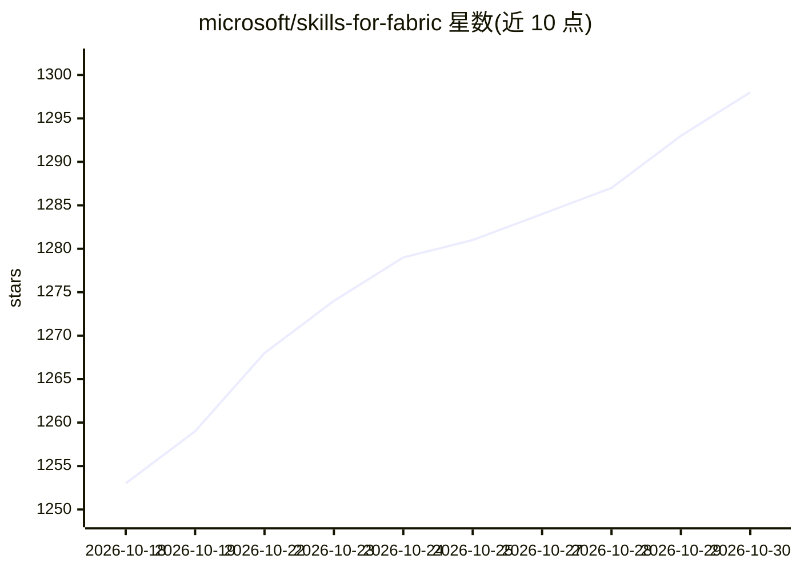

# microsoft/skills-for-fabric

⭐ 1,298 · Python · MIT · 推送 2026-10-29 · [GitHub](https://github.com/microsoft/skills-for-fabric) · 组织维护

**微软 Fabric 的 AI 编码工具技能与 MCP 集合包**

面向 GitHub Copilot CLI、Claude Code、Cursor、Windsurf、Codex 等 AI 编码工具的可复用技能与 MCP server 集合：覆盖 SQL 数仓、Spark/Lakehouse、Power BI 语义模型与报表、KQL/Eventhouse、Dataflows Gen2、迁移与 medallion 架构等 Fabric 工作负载。通过 Copilot CLI 插件市场安装整套包，或用 APM 按 skill 粒度安装到指定工具；多数 Fabric 操作需 Azure CLI 认证。

## 筛选速览

| 维度 | 判定 | 备注 |
|---|---|---|
| AI 角色 | `ai-knowledge` | 知识聚合/清单类 |
| 许可风险 | `permissive` | MIT |
| 部署形态 | `None` |  |
| 模型依赖 | — | README 未给出锁定关系 |
| 硬件要求 | — | 无带数字的原话,不猜 |
| 安装摩擦 | `low` | 无编译、无系统依赖或容器化 |
| 成熟度 | — | 结构信号不足 |

## 能力要点

- fabric-skills 完整包与 powerbi-authoring 独立包两种发行形态
- Copilot CLI /plugin 命令安装，APM 可单 skill 部署到 copilot/claude/cursor/codex 等目标
- 含 MCP server 注册（如 powerbi-modeling-mcp，经 npx 启动）
- 提供 CLAUDE.md/.cursorrules/.windsurfrules/AGENTS.md 等根级兼容配置

## 适用场景

- 让 AI 编码助手按 Fabric 官方模式编写 T-SQL/KQL/Power BI 工作流
- 通过 MCP server 让 agent 直接访问 Fabric 数据源
- 设计 medallion 架构或生成分析 PDF 报告等示例任务

## 场景标签

`提示工程` · 领域:Agent 开发

## 证据(README 行号)

> L3: Microsoft Fabric Skills are reusable AI assistant instructions for working with Microsoft Fabric. They help GitHub C
> L147: |`fabric-skills`|Complete Microsoft Fabric skill bundle, including authoring, consumption, operations, migration, 
> L150: The full bundle includes skills for SQL data warehouse, Spark and Lakehouse, Power BI semantic models, Eventhouse 

## 星数曲线

2026-10-18 1,253 → 2026-10-30 1,298（+45）

---
*卡片 v1 · prompt 1.4 · 生成 2026-10-21 · 置信度 high · 依据 README sha `cd429f2b12d0` · [字段定义](../../DATASET.md)*
