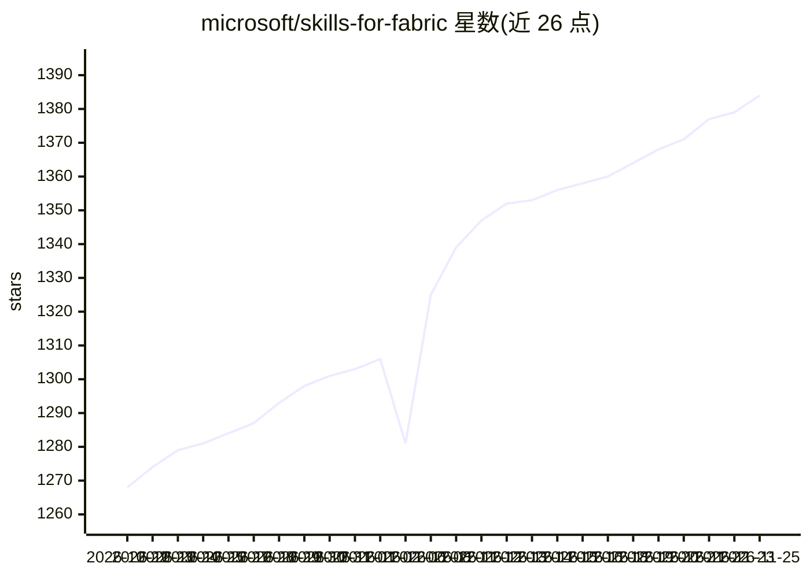

# microsoft/skills-for-fabric

⭐ 1,384 · Python · MIT · 推送 2026-11-20 · [GitHub](https://github.com/microsoft/skills-for-fabric) · 组织维护

**让 AI 编码工具操作 Microsoft Fabric 的技能与 MCP 集合**

微软官方发布的可复用 AI 助手指令集：为 GitHub Copilot CLI、Claude Code、Cursor、Windsurf、Codex 等兼容工具提供理解 Fabric 工作负载、API、查询模式与运维实践的技能，按 `fabric-skills`（全量）与 `powerbi-authoring`（Power BI 创作）两个插件包分发。安装途径包括 Copilot CLI 插件市场、APM 单技能安装（支持 --target 指定工具）以及克隆仓库后由各工具自动读取根配置文件。多数 Fabric 操作需 Azure 认证（az login）；包内含注册为 MCP 服务器的 powerbi-modeling-mcp，经 npx 启动。

## 筛选速览

| 维度 | 判定 | 备注 |
|---|---|---|
| AI 角色 | `ai-knowledge` | 知识聚合/清单类 |
| 许可风险 | `permissive` | MIT |
| 部署形态 | `None` |  |
| 模型依赖 | — | README 未给出锁定关系 |
| 硬件要求 | — | 无带数字的原话,不猜 |
| 安装摩擦 | `low` | 无编译、无系统依赖或容器化 |
| 成熟度 | — | 结构信号不足 |

## 能力要点

- 通过 Copilot CLI 插件市场一键安装 fabric-skills 或 powerbi-authoring 包
- APM (Agent Package Manager) 支持按 --skill 单技能安装、--target 部署到 claude/cursor/codex 等工具
- 根目录含 CLAUDE.md/.cursorrules/.windsurfrules/AGENTS.md/GEMINI.md，克隆仓库即被各工具自动识别
- 技能配合 MCP 服务器提供对数据源和 API 的实时工具访问，复用 Azure CLI 登录

## 适用场景

- 在 Copilot CLI 中让 AI 按最佳实践设计 NYC 出租车数据的 medallion 架构
- 让 AI 助手梳理并文档化我的 Fabric 工作区
- 为 Power BI 语义模型与 PBIP 工作流安装专门的创作技能包
- 迁移与端到端架构场景中为 AI 编码工具注入 Fabric 模式知识

## 场景标签

`编码 Agent` `AI 助手` `数据分析` · 领域:效率与自动化

## 证据(README 行号)

> L3: Microsoft Fabric Skills are reusable AI assistant instructions for working with Microsoft Fabric. They help GitHub C
> L145: |Bundle|Use it for|
> L183: Skills provide guidance and patterns. MCP servers provide live tool access to data sources and APIs. Some bundles 

## 星数曲线

2026-10-22 1,268 → 2026-11-25 1,384（+116）

---
*卡片 v1 · prompt 1.4 · 生成 2026-11-23 · 置信度 high · 依据 README sha `8a6af9b1b9a8` · [字段定义](../../DATASET.md)*
