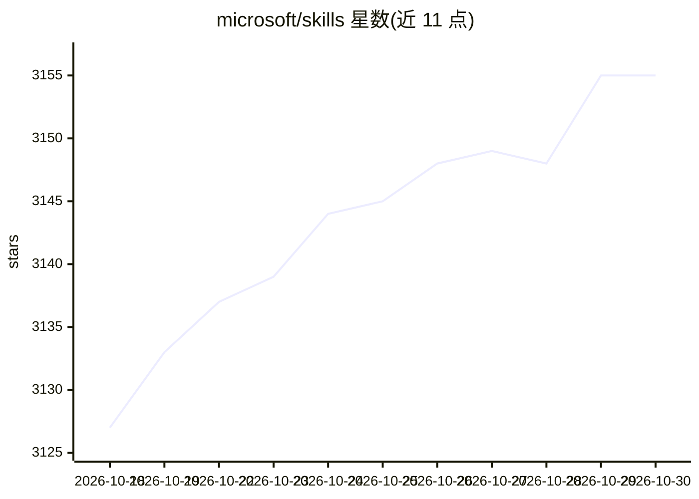

# microsoft/skills

⭐ 3,155 · TypeScript · MIT · 推送 2026-10-29 · [GitHub](https://github.com/microsoft/skills) · [官网](https://microsoft.github.io/skills/) · 组织维护

**面向 AI 编码代理的 Azure/Foundry 技能与模板库**

微软维护的 agent 技能仓库：收录 174/175 个领域技能（SKILL.md 形式），覆盖 Azure SDK（Python 39、.NET 28、TypeScript 25、Java 25、Rust 7）与 Microsoft AI Foundry 平台，另含可安装插件、定制角色代理、AGENTS.md 模板与预配置 MCP server。技能通过 npx skills add 向导安装到所选编码代理目录（如 .github/skills/），也可 git clone 手动复制。仓库标注 Work in Progress，持续新增技能与测试。

## 筛选速览

| 维度 | 判定 | 备注 |
|---|---|---|
| AI 角色 | `ai-knowledge` | 知识聚合/清单类 |
| 许可风险 | `permissive` | MIT |
| 部署形态 | `library` | 以包/库形式分发 |
| 模型依赖 | locked-api |  |
| 硬件要求 | — | 无带数字的原话,不猜 |
| 安装摩擦 | `medium` | 含编译或系统依赖之一 |
| 成熟度 | `idea` | |

## 能力要点

- 175 个技能按语言/平台分类组织，覆盖 6 种语言后缀
- npx skills add 向导式安装，支持多代理符号链接
- 含定制角色代理、AGENTS.md 模板与预配置 MCP server
- Foundry 11 个语言无关技能（部署、编排、记忆、治理）

## 适用场景

- 为 GitHub Copilot 等编码代理补充 Azure SDK 领域知识
- 查找 Foundry 代理开发相关的技能与 MCP 配置
- 按项目需要选择安装特定技能而非全量加载

## 场景标签

`精选清单` · 领域:学习与行业

## 证据(README 行号)

> L11: Skills, custom agents, AGENTS.md templates, and MCP configurations for AI coding agents working with Azure SDKs and
> L15: > **🔍 Skill Explorer:** Browse all 175 skills with 1-click install
> L20: npx skills add microsoft/skills

## 星数曲线

2026-10-18 3,127 → 2026-10-30 3,155（+28）

---
*卡片 v1 · prompt 1.4 · 生成 2026-10-20 · 置信度 high · 依据 README sha `4aea9c08d9f9` · [字段定义](../../DATASET.md)*
