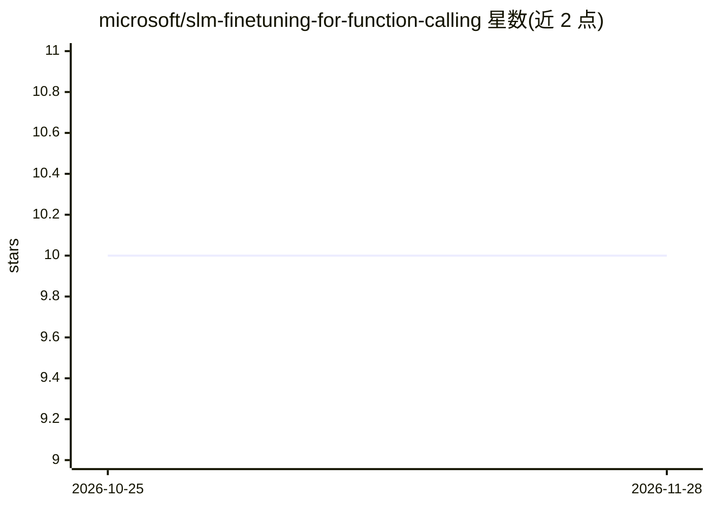

# microsoft/slm-finetuning-for-function-calling

⭐ 10 · Jupyter Notebook · MIT · 推送 2026-10-10 · [GitHub](https://github.com/microsoft/slm-finetuning-for-function-calling) · 组织维护

**面向开发者的 SLM 微调与评估教学实验**

微软 AI Learning Day 配套的教学实验仓库，包含两个实验：SLM 微调实验覆盖首次运行模型、推理、微调与性能调优；评估实验聚焦评估指标与错误分析。内容以 Jupyter Notebook 形式提供，在 VS Code 中运行，设计为由浅入深的交互式教程，面向从初学者到进阶用户。环境设置提供 GitHub Codespaces、远程 Azure VM、本地 Dev Container 或 virtualenv 三类路径。

## 筛选速览

| 维度 | 判定 | 备注 |
|---|---|---|
| AI 角色 | `ai-knowledge` | 知识聚合/清单类 |
| 许可风险 | `permissive` | MIT |
| 部署形态 | `None` |  |
| 模型依赖 | — | README 未给出锁定关系 |
| 硬件要求 | — | 无带数字的原话,不猜 |
| 安装摩擦 | `low` | 无编译、无系统依赖或容器化 |
| 成熟度 | — | 结构信号不足 |

## 能力要点

- 两个实验：SLM 微调（推理/微调/性能调优）与评估（指标/错误分析）
- Jupyter Notebook + VS Code 形式的交互式教程
- 三种环境设置路径：GitHub Codespaces、Azure 远程 VM、本地 Dev Container/virtualenv

## 适用场景

- 学习小语言模型的微调流程与函数调用
- 为 SLM 搭建评估指标与错误分析流程
- 按自身硬件条件选择云端或本地实验环境

## 场景标签

`教程课程` `微调` `模型评测` · 领域:评测与运维

## 证据(README 行号)

> L1: # SLM fine-tuning & evaluation labs
> L3: This repository contains labs for finetuning and evaluating Small Language Models (SLMs) developed for the AI Learni
> L40: This repo contains two labs:

## 星数曲线

2026-10-25 10 → 2026-11-28 10（+0）

---
*卡片 v1 · prompt 1.4 · 生成 2026-11-19 · 置信度 high · 依据 README sha `821df60109ec` · [字段定义](../../DATASET.md)*
