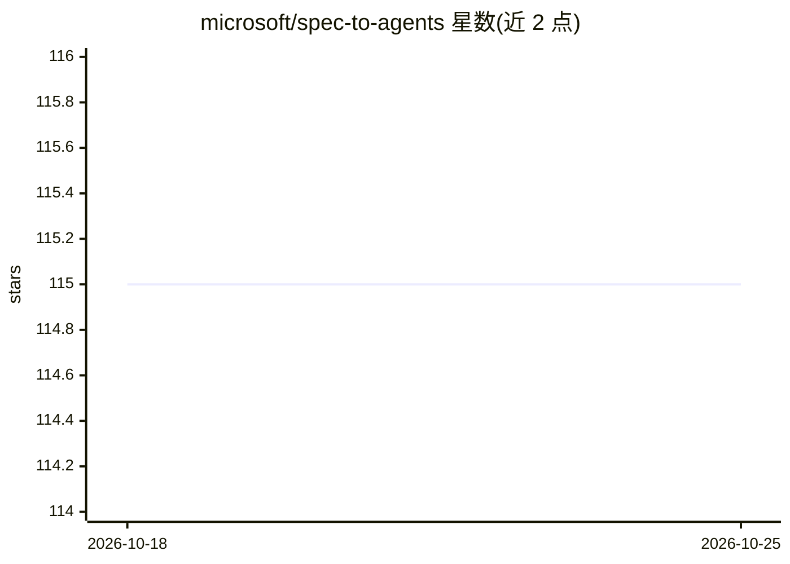

# microsoft/spec-to-agents

⭐ 115 · Python · MIT · 推送 2026-06-12 · [GitHub](https://github.com/microsoft/spec-to-agents) · [官网](https://learn.microsoft.com/en-us/agent-framework/overview/agent-framework-overview) · 组织维护

**基于 Microsoft Agent Framework 的多智能体活动策划示例**

微软官方示例项目，演示如何用 Microsoft Agent Framework（融合 Semantic Kernel 编排与 AutoGen 多智能体模式）构建活动策划多智能体系统：5 个专职智能体（场地、预算、餐饮、物流、协调者）以星型拓扑协作，集成 Bing 网络搜索、Open-Meteo 天气 API、iCalendar、代码解释器与 MCP 工具，支持 Human-in-the-Loop 审批与结构化输出路由。面向学习该框架的开发者，需 Python 3.11+、uv、Azure 订阅，可用 azd 一键部署到 Azure（Provision Foundry/Azure OpenAI 模型）。

## 筛选速览

| 维度 | 判定 | 备注 |
|---|---|---|
| AI 角色 | `ai-ecosystem` | LLM/agent 周边工具 |
| 许可风险 | `permissive` | MIT |
| 部署形态 | `None` |  |
| 模型依赖 | locked-api |  |
| 硬件要求 | — | 无带数字的原话,不猜 |
| 安装摩擦 | `low` | 无编译、无系统依赖或容器化 |
| 成熟度 | — | 结构信号不足 |

## 能力要点

- 5 个专职智能体的协调者中心星型拓扑协作
- Human-in-the-Loop 审批与服务托管会话线程（store=True）
- 集成 Bing 搜索、天气 API、日历、代码解释器与 MCP 工具
- azd 一键部署 Azure Foundry 与 Azure OpenAI 模型

## 适用场景

- 学习用 Microsoft Agent Framework 构建多智能体工作流
- 参考 Human-in-the-Loop 与结构化输出路由的实现方式
- 作为 Azure 上多智能体应用的部署起点

## 场景标签

`Agent 框架` `多智能体` · 领域:Agent 开发

## 证据(README 行号)

> L7: A multi-agent event planning workflow built with **Microsoft Agent Framework** - combining Semantic Kernel's enterpr
> L14: This sample shows you how to build a production-ready multi-agent system with:

## 星数曲线

2026-10-18 115 → 2026-10-25 115（+0）

---
*卡片 v1 · prompt 1.4 · 生成 2026-10-23 · 置信度 high · 依据 README sha `9fb8b47d0137` · [字段定义](../../DATASET.md)*
