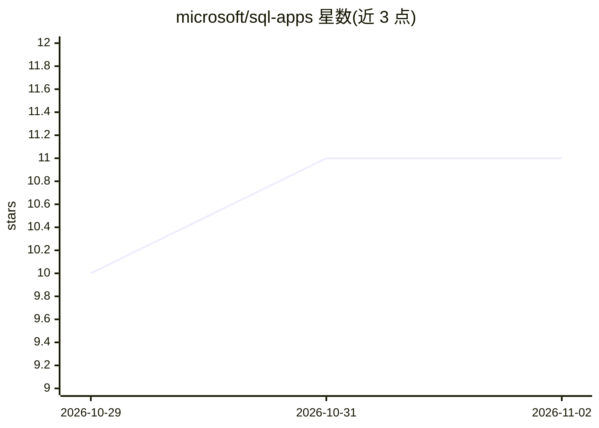

# microsoft/sql-apps

⭐ 11 · JavaScript · MIT · 推送 2026-10-28 · [GitHub](https://github.com/microsoft/sql-apps) · 组织维护

**引导 AI 编程助手搭建 SQL 后端 Web 应用的插件与指南**

面向使用 GitHub Copilot、Claude Code、Codex、Gemini CLI、Cursor 等编程助手的开发者：SQL Apps 是一个轻量插件（marketplace 坐标 sql-apps@sql-apps-skills），通过指南约束助手行为，从需求描述出发生成带屏幕、登录、SQL 数据访问与测试的 TypeScript/React/Azure SQL 应用，最终应用可脱离插件独立运行。附带 Azure 部署指南（Container Apps/App Service/Static Web Apps）。版本 0.3.0 处于 preview，五个助手家族的安装包未经完整端到端测试；仅支持 Azure SQL Database，不支持本地 SQL Server；本地开发数据库容器为 Private Preview 且不含在内。

## 筛选速览

| 维度 | 判定 | 备注 |
|---|---|---|
| AI 角色 | `ai-ecosystem` | LLM/agent 周边工具 |
| 许可风险 | `permissive` | MIT |
| 部署形态 | `None` |  |
| 模型依赖 | — | README 未给出锁定关系 |
| 硬件要求 | — | 无带数字的原话,不猜 |
| 安装摩擦 | `low` | 无编译、无系统依赖或容器化 |
| 成熟度 | `idea` | |

## 能力要点

- 以插件形式引导编程助手而非托管应用，成品应用不依赖插件运行
- 可复制应用起始骨架：屏幕、登录、数据库访问与首版检查
- 支持 5 个助手家族安装（Copilot/Claude Code/Codex/Gemini CLI/Cursor）
- 附带 Azure 部署指南与 Bicep/Container Apps 部署配方

## 适用场景

- 用已有的 AI 编程助手从想法出发搭建 SQL 后端业务应用
- 在本地起步后按指南迁移到 Azure 云部署
- 减少 Web 应用登录、数据访问等重复性初始搭建工作

## 场景标签

`代码生成` · 领域:编码与开发

## 证据(README 行号)

> L9: SQL Apps is a lightweight plugin that guides your assistant—not a service that hosts your app. No SQL Apps account o
> L24: |GitHub Copilot / VS Code|Plugin marketplace or local setup|
> L25: |Claude Code|Plugin marketplace|

## 星数曲线

2026-10-29 10 → 2026-11-02 11（+1）

---
*卡片 v1 · prompt 1.4 · 生成 2026-11-02 · 置信度 high · 依据 README sha `2ea23945904e` · [字段定义](../../DATASET.md)*
