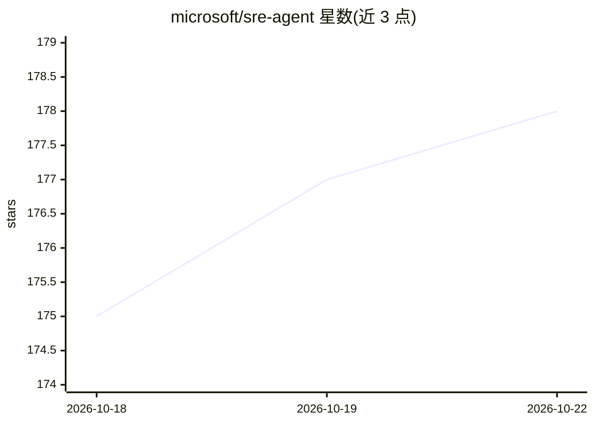

# microsoft/sre-agent

⭐ 179 · PowerShell · MIT · 推送 2026-10-21 · [GitHub](https://github.com/microsoft/sre-agent) · 组织维护

**微软 Azure SRE Agent 的官方社区资源仓库**

本仓库是 Azure SRE Agent（微软的 AI 可靠性助手产品，用于诊断与修复生产问题）的官方社区枢纽：收录 Issue 反馈入口、文档/视频/博客链接、hands-on 实验环境（labs/ 目录）以及社区与官方插件仓库等资源。仓库本身不包含产品代码，产品通过 Azure 门户创建与管理并按用量计费；README 同时汇总 GA 与 //Build 发布的功能公告博客。

## 筛选速览

| 维度 | 判定 | 备注 |
|---|---|---|
| AI 角色 | `ai-ecosystem` | LLM/agent 周边工具 |
| 许可风险 | `permissive` | MIT |
| 部署形态 | `None` |  |
| 模型依赖 | — | README 未给出锁定关系 |
| 硬件要求 | — | 无带数字的原话,不猜 |
| 安装摩擦 | `medium` | 含编译或系统依赖之一 |
| 成熟度 | — | 结构信号不足 |

## 能力要点

- 汇集 Azure SRE Agent 官方文档、定价与社区链接
- labs/ 目录提供可部署、可破坏与修复的实验环境
- 跟踪官方插件仓库与 3 个相关 GitHub 仓库

## 适用场景

- 查找 Azure SRE Agent 的官方文档与学习视频
- 在实验环境中上手 SRE Agent 的故障诊断流程
- 提交产品缺陷或功能反馈

## 场景标签

`精选清单` `教程课程` · 领域:学习与行业

## 证据(README 行号)

> L3: This repository is the official community hub for Azure SRE Agent. Here you'll find:
> L7: - **🧪 Labs** — Hands-on labs and sample environments to deploy, break, and fix apps with Azure SRE Agent (see the `l

## 星数曲线

2026-10-18 175 → 2026-10-22 178（+3）

---
*卡片 v1 · prompt 1.4 · 生成 2026-10-22 · 置信度 mid · 依据 README sha `7e9570711cce` · [字段定义](../../DATASET.md)*
