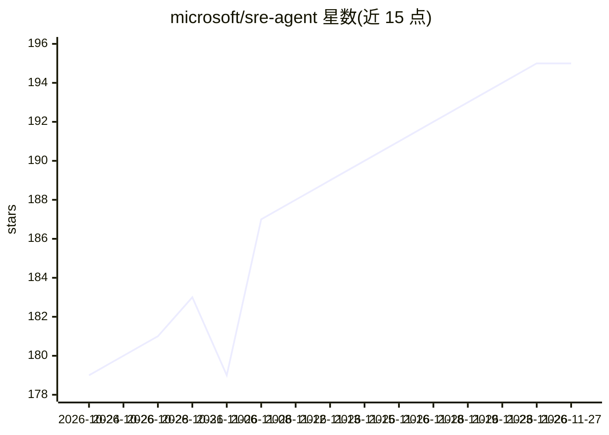

# microsoft/sre-agent

⭐ 195 · PowerShell · MIT · 推送 2026-11-25 · [GitHub](https://github.com/microsoft/sre-agent) · 组织维护

**Azure SRE Agent 的官方资源中心：事件诊断运维助手**

该仓库是 Azure SRE Agent 的官方社区资源中心，本身不含安装代码，提供问题反馈入口、文档/博客/视频链接索引、Hands-on Lab 实验环境（labs/ 目录）与官方插件仓库链接。产品本体为运行在 Azure 上的 AI 可靠性助手，可自动调查生产事件、执行修复流程、集成 Azure Monitor/GitHub/Dynatrace 等连接器，并提供 hooks 治理与插件市场机制。面向使用 Azure 的工程与运维团队，通过门户创建与管理 agent，按 active flow 计费。

## 筛选速览

| 维度 | 判定 | 备注 |
|---|---|---|
| AI 角色 | `ai-native` | 本体是模型或模型工具 |
| 许可风险 | `permissive` | MIT |
| 部署形态 | `None` |  |
| 模型依赖 | — | README 未给出锁定关系 |
| 硬件要求 | — | 无带数字的原话,不猜 |
| 安装摩擦 | `medium` | 含编译或系统依赖之一 |
| 成熟度 | — | 结构信号不足 |

## 能力要点

- 官方资源中心：文档、博客、视频、Labs 的索引入口
- 自动调查生产事件并执行修复，支持 Azure Monitor/Log Analytics/App Insights 连接器
- 提供 hooks 治理机制（stop/PostToolUse/global hooks）与私有插件市场
- 多租户场景支持 Azure Lighthouse 委托管理

## 适用场景

- 自动调查与缓解 Azure 生产环境告警事件
- 在 Teams 中协作处理运维工单以缩短 MTTR
- 跨多个订阅/租户集中监控管理资源
- 通过 labs 环境演练部署、故障与修复流程

## 场景标签

`AI 助手` `工作流自动化` · 领域:效率与自动化

## 证据(README 行号)

> L3: This repository is the official community hub for Azure SRE Agent. Here you'll find:
> L11: Meet your AI teammate for cloud operations: investigate incidents, reduce operational toil, and move from reactive 
> L104: |Portal (Create & Manage Agents)|<https://aka.ms/sreagent>|

## 星数曲线

2026-10-24 179 → 2026-11-27 195（+16）

---
*卡片 v1 · prompt 1.4 · 生成 2026-11-25 · 置信度 high · 依据 README sha `eedd03f3d66e` · [字段定义](../../DATASET.md)*
