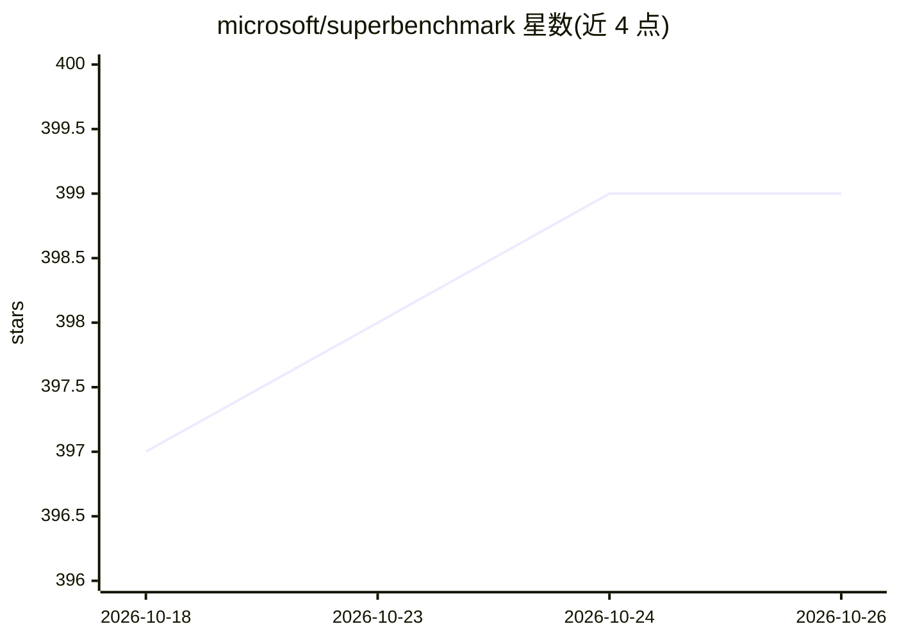

# microsoft/superbenchmark

⭐ 399 · Python · MIT · 推送 2026-10-23 · [GitHub](https://github.com/microsoft/superbenchmark) · [官网](https://aka.ms/superbench) · 组织维护

**面向 AI 基础设施的验证与性能剖析工具**

微软维护的 AI 基础设施（含云端集群）验证与剖析工具，用于基础设施的主动验证与可靠性检查。以 Docker 镜像形式分发（README 含 Docker Pulls 徽章与 Build Image 流水线），CI 覆盖 CPU 单元测试、CUDA 单元测试与 Ansible 集成测试。当前版本 v0.12.0，更多细节指向 aka.ms/superbench 网站；README 提供 BibTeX 引用，对应发表于云 AI 基础设施可靠性验证的论文。给基础设施工程师与平台团队使用。

## 筛选速览

| 维度 | 判定 | 备注 |
|---|---|---|
| AI 角色 | `ai-ecosystem` | LLM/agent 周边工具 |
| 许可风险 | `permissive` | MIT |
| 部署形态 | `self-host` | docker 或自建部署 |
| 模型依赖 | — | README 未给出锁定关系 |
| 硬件要求 | — | 无带数字的原话,不猜 |
| 安装摩擦 | `low` | 无编译、无系统依赖或容器化 |
| 成熟度 | — | 结构信号不足 |

## 能力要点

- 对 AI 基础设施做验证与性能剖析
- Docker 镜像分发与 CI 流水线（CPU/CUDA 单元测试、Ansible 集成测试）
- v0.12.0 已发布，配套网站 aka.ms/superbench

## 适用场景

- 云 AI 集群上线前做基础设施验证
- 对 GPU 等硬件环境进行基准与剖析
- 在论文中引用其基础设施可靠性验证工作

## 场景标签

 · 领域:AI 系统运维/基准测试

## 证据(README 行号)

> L16: __SuperBench__ is a validation and profiling tool for AI infrastructure.
> L29: 	title = {{SuperBench}: Improving Cloud {AI} Infrastructure Reliability with Proactive Validation},

## 星数曲线

2026-10-18 397 → 2026-10-26 399（+2）

---
*卡片 v1 · prompt 1.4 · 生成 2026-10-21 · 置信度 high · 依据 README sha `622bdc74f330` · [字段定义](../../DATASET.md)*
