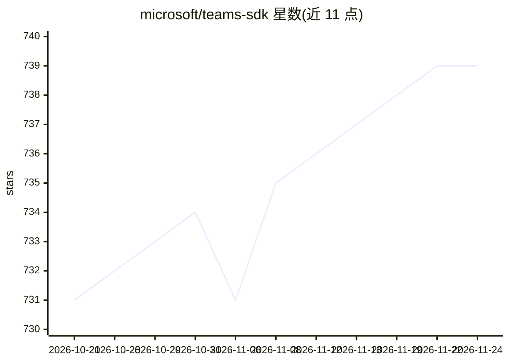

# microsoft/teams-sdk

⭐ 739 · TypeScript · MIT · 推送 2026-11-20 · [GitHub](https://github.com/microsoft/teams-sdk) · 组织维护

**面向开发者的 Microsoft Teams 应用与 AI agent 开发 SDK**

Microsoft 官方的 Teams 开发框架文档仓库，从 Teams AI 更名为 Teams SDK，覆盖 AI agent、消息扩展、嵌入式 Web 应用和 Graph 集成等开发场景，保持与既有 Bot Framework agent 的兼容。SDK 按 TypeScript、C#、Python 三种语言分仓维护，通过 Teams Developer CLI 脚手架初始化项目。仓库当前处于 v1 到 v2 的过渡期，v1 移至 release/v1 分支仅提供关键修复与安全补丁。

## 筛选速览

| 维度 | 判定 | 备注 |
|---|---|---|
| AI 角色 | `ai-ecosystem` | LLM/agent 周边工具 |
| 许可风险 | `permissive` | MIT |
| 部署形态 | `library` | 以包/库形式分发 |
| 模型依赖 | — | README 未给出锁定关系 |
| 硬件要求 | — | 无带数字的原话,不猜 |
| 安装摩擦 | `low` | 无编译、无系统依赖或容器化 |
| 成熟度 | — | 结构信号不足 |

## 能力要点

- 支持 TypeScript、C#、Python 三种语言的 SDK，分仓维护
- 统一覆盖 AI agent、消息扩展、Web 应用与 Graph 集成
- Teams Developer CLI 脚手架初始化 agent 项目
- 与既有 botframework-based agent 保持兼容

## 适用场景

- 在 Teams 中开发 AI-powered agent
- 构建 Teams 消息扩展与嵌入式 Web 应用
- 将现有 Bot Framework agent 迁移到新框架

## 场景标签

`Agent 框架` `聊天机器人` · 领域:Agent 开发

## 证据(README 行号)

> L3: Teams SDK represents a fundamental reimagining of how Teams apps and AI agents are built, while maintaining compatib
> L39: Microsoft Teams has a robust developer ecosystem with a broad suite of capabilities, now unified via Teams SDK. Whe

## 星数曲线

2026-10-21 731 → 2026-11-24 739（+8）

---
*卡片 v1 · prompt 1.4 · 生成 2026-11-24 · 置信度 high · 依据 README sha `60e0f688ee01` · [字段定义](../../DATASET.md)*
