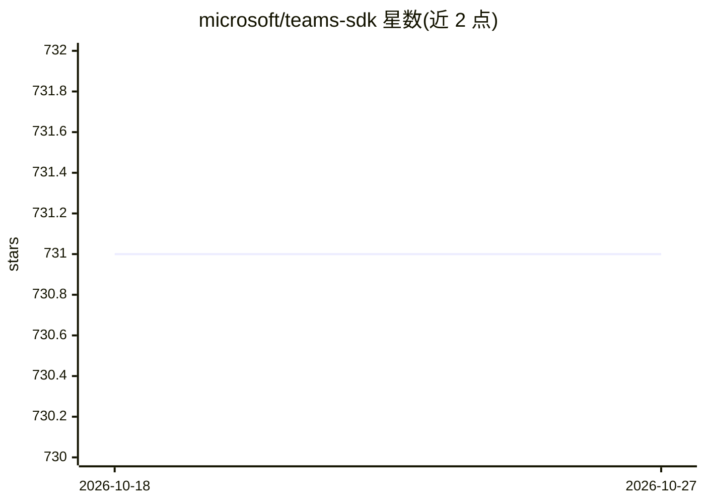

# microsoft/teams-sdk

⭐ 731 · TypeScript · MIT · 推送 2026-10-26 · [GitHub](https://github.com/microsoft/teams-sdk) · 组织维护

**微软官方 Teams 应用与 AI agent 开发 SDK 文档仓库**

原 Teams AI 更名为 Teams SDK，定位为构建 Teams 应用与 AI agent 的综合开发框架，兼容基于 Bot Framework 的既有 agent。代码按语言拆分在 TypeScript、C#、Python 独立仓库，本仓库承载文档。提供 Teams Developer CLI（npm 安装）快速创建 agent，配套开源 Agent Accelerator 模板，能力覆盖 AI agent、Message Extensions、嵌入式 Web 应用与 Graph 访问。v1 已移至 release/v1 分支，仅继续提供关键修复与安全补丁。

## 筛选速览

| 维度 | 判定 | 备注 |
|---|---|---|
| AI 角色 | `ai-ecosystem` | LLM/agent 周边工具 |
| 许可风险 | `permissive` | MIT |
| 部署形态 | `library` | 以包/库形式分发 |
| 模型依赖 | — | README 未给出锁定关系 |
| 硬件要求 | — | 无带数字的原话,不猜 |
| 安装摩擦 | `low` | 无编译、无系统依赖或容器化 |
| 成熟度 | — | 结构信号不足 |

## 能力要点

- 提供 CLI 一条命令创建 TypeScript/C#/Python agent
- 支持 AI agent、Message Extensions、嵌入式 Web 应用与 Graph 能力
- 维护 v1（release/v1）与 v2（main）双分支
- 配套开源 Agent Accelerator 模板

## 适用场景

- 在 Teams 内构建 AI agent 或机器人
- 为 Teams 开发消息扩展与嵌入式 Web 应用
- 通过 CLI 与模板快速启动 Teams agent 项目

## 场景标签

`Agent 框架` · 领域:Agent 开发

## 证据(README 行号)

> L3: Teams SDK represents a fundamental reimagining of how Teams apps and AI agents are built, while maintaining compatib
> L43: Microsoft Teams has a robust developer ecosystem with a broad suite of capabilities, now unified via Teams SDK. Whe

## 星数曲线

2026-10-18 731 → 2026-10-27 731（+0）

---
*卡片 v1 · prompt 1.4 · 生成 2026-10-21 · 置信度 high · 依据 README sha `f13085ce3ed1` · [字段定义](../../DATASET.md)*
