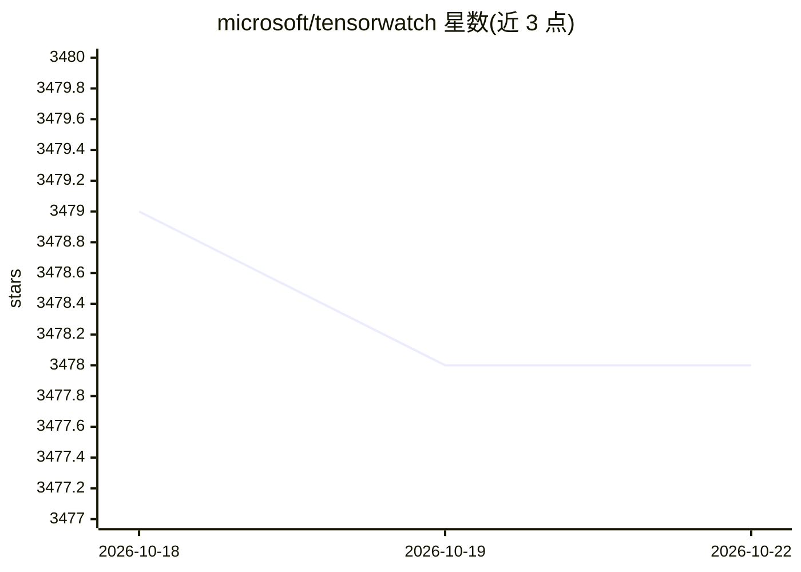

# microsoft/tensorwatch

⭐ 3,478 · Jupyter Notebook · MIT · 推送 2026-03-30 · [GitHub](https://github.com/microsoft/tensorwatch) · 组织维护

**微软研究院出品的 ML 训练实时调试与可视化工具**

面向数据科学、深度学习与强化学习开发者的调试与可视化工具，在 Jupyter Notebook 中实时展示训练过程。核心机制为流（stream）架构：文件、socket、控制台与可视化器均为流，可相互监听构成数据流图；Lazy Logging Mode 支持向运行中的训练进程发送任意 Python 查询并以流返回结果。集成 hiddenlayer、torchstat 等库提供模型图、层统计、t-SNE 与 CNN 预测解释。README 声明其处于重度开发阶段，并包含多项安全注意事项（eval、pickle 等），明确不适用于生产环境。

## 筛选速览

| 维度 | 判定 | 备注 |
|---|---|---|
| AI 角色 | `ai-ecosystem` | LLM/agent 周边工具 |
| 许可风险 | `permissive` | MIT |
| 部署形态 | `library` | 以包/库形式分发 |
| 模型依赖 | — | README 未给出锁定关系 |
| 硬件要求 | — | 无带数字的原话,不猜 |
| 安装摩擦 | `low` | 无编译、无系统依赖或容器化 |
| 成熟度 | `idea` | |

## 能力要点

- 流架构：文件/socket/可视化器均可为流并相互监听，构成数据流图
- Lazy Logging Mode：对运行中的训练进程执行任意查询并以流返回
- 模型图与层统计（flops、参数量）、t-SNE 数据可视化、CNN 预测解释（含 Lime）
- 多实验结果对比与自定义可视化组件扩展

## 适用场景

- 在 Jupyter Notebook 中实时监控深度学习训练指标
- 训练运行中动态查询变量与中间结果而无需预先埋日志
- 查看模型结构、参数统计并解释 CNN 预测依据

## 场景标签

`MLOps` · 领域:训练与推理

## 证据(README 行号)

> L3: TensorWatch is a debugging and visualization tool designed for data science, deep learning and reinforcement learnin
> L5: TensorWatch is designed to be flexible and extensible so you can also build your own custom visualizations, UIs, and

## 星数曲线

2026-10-18 3,479 → 2026-10-22 3,478（-1）

---
*卡片 v1 · prompt 1.4 · 生成 2026-10-20 · 置信度 high · 依据 README sha `a79bd03a1836` · [字段定义](../../DATASET.md)*
