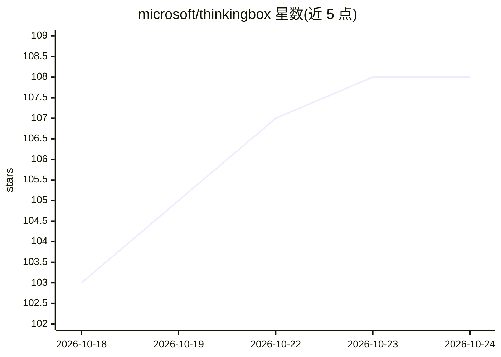

# microsoft/thinkingbox

⭐ 109 · Python · MIT · 推送 2026-10-15 · [GitHub](https://github.com/microsoft/thinkingbox) · 组织维护

**微软的 MCP 工具 agent 评测框架，用于离线训练数据生成与 RL 训练**

ThinkingBox 是微软开源的框架，将工具定义为 MCP 服务器（含 mock），运行 LLM agent 与工具交互并由模拟用户与评判器评估执行结果，用于离线训练数据生成、强化学习训练回路和模型评测。架构含 MCP Session Proxy（隔离的工具执行会话）、tb CLI、TUI 交互界面。分三个仓库：框架本体、数据集与工具服务器（thinkingbox-data）、RL 后训练（thinkingbox-training，支持 GRPO/LoRA/vLLM serving）。仅在 Linux（含 WSL）测试，推荐 uv + Python 3.12 安装。

## 筛选速览

| 维度 | 判定 | 备注 |
|---|---|---|
| AI 角色 | `ai-ecosystem` | LLM/agent 周边工具 |
| 许可风险 | `permissive` | MIT |
| 部署形态 | `library` | 以包/库形式分发 |
| 模型依赖 | local-ok | 支持本地模型 |
| 硬件要求 | — | 无带数字的原话,不猜 |
| 安装摩擦 | `low` | 无编译、无系统依赖或容器化 |
| 成熟度 | — | 结构信号不足 |

## 能力要点

- 以 MCP Session Proxy 生成隔离的工具执行会话并回收副作用用于评判
- 支持离线训练数据生成与 GRPO/LoRA 强化学习训练回路（thinkingbox-training）
- 提供 tb CLI：infer/pp/agg/mcp-start/tui 等命令
- 支持 Azure OpenAI、OpenAI 兼容（vLLM 配置示例）、Anthropic 端点

## 适用场景

- 为 LLM 工具调用能力生成离线训练/评测数据
- 在 RL 训练回路中用工具场景与评判奖励训练模型
- 编写带断言、模拟用户与 LLM 评判的 agent 测试用例

## 场景标签

`模型评测` `强化学习` · 领域:评测与运维

## 证据(README 行号)

> L5: ThinkingBox is a framework designed to:
> L8: - Run an LLM agent and enable interaction with tools.
> L9: - Evaluate the outcomes of agent execution.

## 星数曲线

2026-10-18 103 → 2026-10-24 108（+5）

---
*卡片 v1 · prompt 1.4 · 生成 2026-10-23 · 置信度 mid · 依据 README sha `47841df03f2e` · [字段定义](../../DATASET.md)*
