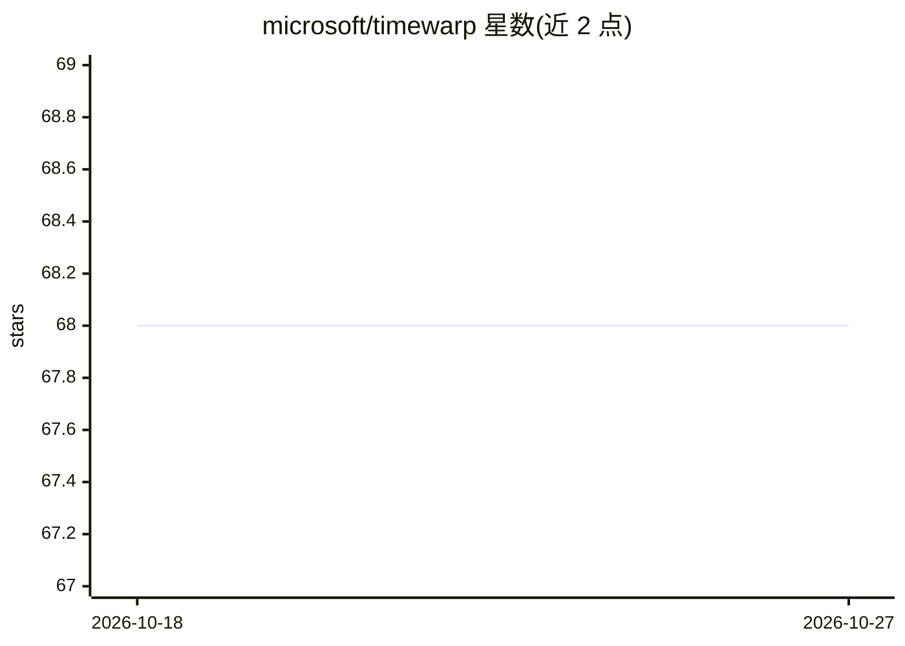

# microsoft/timewarp

⭐ 68 · Python · MIT · 推送 2026-08-27 · [GitHub](https://github.com/microsoft/timewarp) · 组织维护

**用深度学习加速分子动力学模拟的科研代码库**

微软研究院的科研代码，配套论文 Timewarp: Transferable Acceleration of Molecular Dynamics by Learning Time-Coarsened Dynamics。实现多种条件密度模型 p(y|x)，根据分子当前状态预测未来 3D 位置，用于小肽（2-4 氨基酸）平衡分布采样以加速分子动力学模拟。提供训练脚本（含 deepspeed 多 GPU）、采样与评估脚本，训练数据与模型检查点放在 Hugging Face。局限：仅适用于很小肽段，许多情况下无实际墙钟加速，限研究用途。

## 筛选速览

| 维度 | 判定 | 备注 |
|---|---|---|
| AI 角色 | `ai-native` | 本体是模型或模型工具 |
| 许可风险 | `permissive` | MIT |
| 部署形态 | `None` |  |
| 模型依赖 | — | README 未给出锁定关系 |
| 硬件要求 | — | 无带数字的原话,不猜 |
| 安装摩擦 | `low` | 无编译、无系统依赖或容器化 |
| 成熟度 | — | 结构信号不足 |

## 能力要点

- 条件密度模型 p(y|x) 预测分子未来状态
- 提供训练/采样/评估脚本与 yaml 实验配置
- deepspeed 多 GPU 数据并行训练
- 训练数据与检查点托管于 Hugging Face

## 适用场景

- 复现论文中 kernel transformerNVP 等模型实验
- 对小肽做平衡分布采样与能量/内坐标分布分析
- 作为分子动力学加速方向的研究基线代码

## 场景标签

`科研工具` · 领域:学习与行业

## 证据(README 行号)

> L90:  - Timewarp is a neural network that predicts the future 3D positions of a small peptide (2- 4 amino acids) based o
> L94:  - Timewarp is intended for machine learning and molecular dynamics research purposes only.

## 星数曲线

2026-10-18 68 → 2026-10-27 68（+0）

---
*卡片 v1 · prompt 1.4 · 生成 2026-10-24 · 置信度 high · 依据 README sha `50320fbfd6b7` · [字段定义](../../DATASET.md)*
