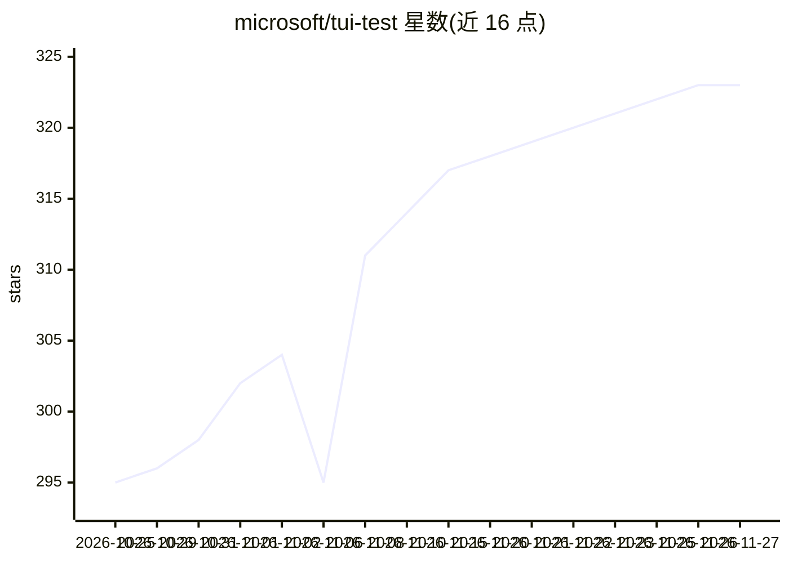

# microsoft/tui-test

⭐ 323 · Rust · MIT · 推送 2026-11-26 · [GitHub](https://github.com/microsoft/tui-test) · [官网](https://tui-test.dev) · 组织维护

**让 AI 代理控制、录制与测试终端 TUI 应用的工具**

tui-test 提供 CLI 与 Rust/Python/JavaScript/Go 四种语言库，用于控制、检查、测试并录制真实的 shell 会话与全屏终端应用，支持 Windows、Linux 和 macOS。核心能力包括生成终端端到端测试（expect/click 等断言操作）、录制视频/GIF 截图，以及向 AI 代理暴露终端状态的结构化访问；还提供 agent skill 安装方式（Vercel skills CLI 或 tui-test CLI）。

## 筛选速览

| 维度 | 判定 | 备注 |
|---|---|---|
| AI 角色 | `ai-ecosystem` | LLM/agent 周边工具 |
| 许可风险 | `permissive` | MIT |
| 部署形态 | `library` | 以包/库形式分发 |
| 模型依赖 | — | README 未给出锁定关系 |
| 硬件要求 | — | 无带数字的原话,不猜 |
| 安装摩擦 | `low` | 无编译、无系统依赖或容器化 |
| 成熟度 | — | 结构信号不足 |

## 能力要点

- CLI 与 Rust/Python/JavaScript/Go 多语言库
- 对终端应用执行 expect/click 断言式端到端测试
- 录制终端视频/GIF 与 SVG 截图
- 可作为 agent skill 安装，向 AI 代理暴露结构化终端访问

## 适用场景

- 为 TUI/CLI 应用编写端到端测试
- 让 AI 代理在脚本化终端会话中执行操作
- 录制终端操作的演示视频或 GIF

## 场景标签

`GUI 自动化` · 领域:效率与自动化

## 证据(README 行号)

> L7: `tui-test` controls, inspects, tests, and records real shell sessions and full-screen terminal apps on Windows, Linu
> L32: ### Agent skill

## 星数曲线

2026-10-25 295 → 2026-11-27 323（+28）

---
*卡片 v1 · prompt 1.4 · 生成 2026-11-25 · 置信度 high · 依据 README sha `410c3bff6e6c` · [字段定义](../../DATASET.md)*
