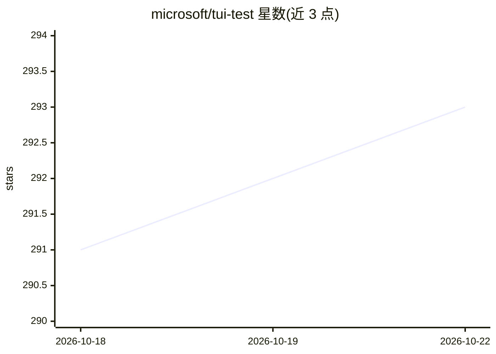

# microsoft/tui-test

⭐ 293 · Rust · MIT · 推送 2026-10-22 · [GitHub](https://github.com/microsoft/tui-test) · 组织维护

**控制、录制与测试终端/TUI 应用的跨平台工具，供 AI agent 结构化访问终端**

在 Windows/Linux/macOS 上控制、检查、测试并录制真实 shell 会话与全屏终端应用的工具。以 CLI 与 Rust/Python/JavaScript/Go 库形式提供同一引擎；支持文本定位器、键鼠模拟、快照断言、SVG/PNG 截图与 APNG/GIF/MP4/asciinema 录制、失败 trace 产物（trace.md/json/timeline.json）。面向终端自动化、TUI 应用测试，以及需要结构化读取终端状态的 AI agent；agent 可通过 agent-context/skill 命令获取 JSON 命令模式与技能指南。支持 bash/fish/PowerShell 等 9 种 shell 与 Alacritty/Ghostty 等 4 种后端。

## 筛选速览

| 维度 | 判定 | 备注 |
|---|---|---|
| AI 角色 | `ai-enhanced` | 去掉 AI 部分产品仍成立 |
| 许可风险 | `permissive` | MIT |
| 部署形态 | `library` | 以包/库形式分发 |
| 模型依赖 | — | README 未给出锁定关系 |
| 硬件要求 | — | 无带数字的原话,不猜 |
| 安装摩擦 | `medium` | 含编译或系统依赖之一 |
| 成熟度 | — | 结构信号不足 |

## 能力要点

- CLI 与 Rust/Python/JavaScript/Go 四语言库共用同一引擎
- 文本定位器（find/expect/click/highlight）支持正则、锚点与样式匹配
- 截图与 APNG/GIF/MP4/asciinema 录制，失败时保留 trace 与自动 cast
- agent-context/skill 命令输出 JSON 命令模式与 agent 技能指南

## 适用场景

- 对 CLI/TUI 应用做端到端测试与快照断言
- 让 AI agent 结构化读取并操作终端会话
- 录制终端操作生成动画演示或失败证据

## 场景标签

`GUI 自动化` · 领域:效率与自动化

## 证据(README 行号)

> L3: `tui-test` controls, inspects, tests, and records real shell sessions and full-screen terminal apps on Windows, Linu
> L357: ### Agent commands

## 星数曲线

2026-10-18 291 → 2026-10-22 293（+2）

---
*卡片 v1 · prompt 1.4 · 生成 2026-10-22 · 置信度 high · 依据 README sha `abba6321768a` · [字段定义](../../DATASET.md)*
