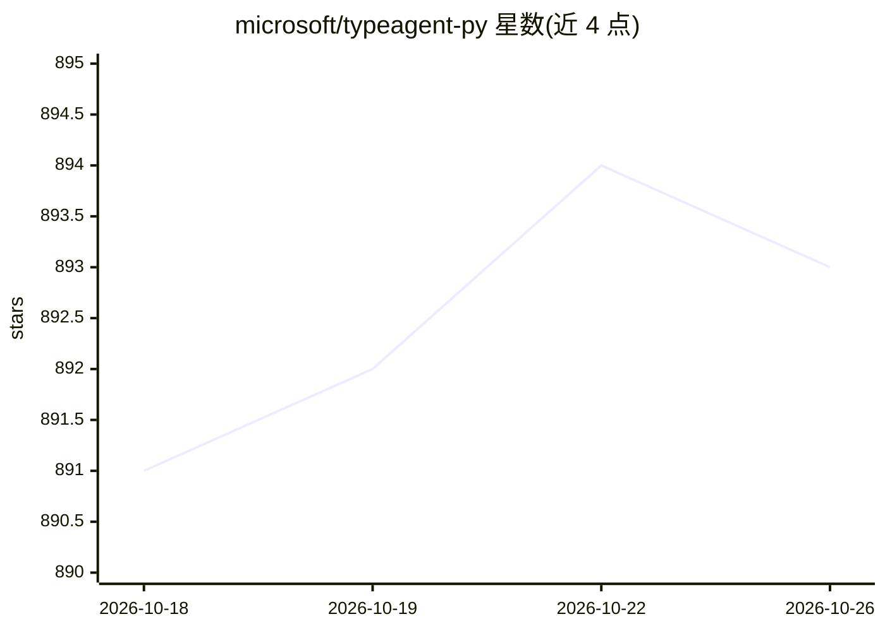

# microsoft/typeagent-py

⭐ 893 · Python · MIT · 推送 2026-10-25 · [GitHub](https://github.com/microsoft/typeagent-py) · 组织维护

**微软的结构化 RAG 原型库：数据摄取、索引与查询**

微软开源的实验性 Python 库，目标是将 TypeScript 版 TypeAgent KnowPro 及相关包转译为 Python，探索结构化 RAG 的共享 MVP 形态。定位为示例代码与进行中项目，README 未给出完整 API 细节，文档位于 docs 目录。通过 pip 安装。注意事项：该库会把输入发送给第三方托管的 LLM，README 明确警告不要用于索引机密信息。另有 PyBay '25 演讲幻灯片与视频资料。

## 筛选速览

| 维度 | 判定 | 备注 |
|---|---|---|
| AI 角色 | `ai-ecosystem` | LLM/agent 周边工具 |
| 许可风险 | `permissive` | MIT |
| 部署形态 | `library` | 以包/库形式分发 |
| 模型依赖 | — | README 未给出锁定关系 |
| 硬件要求 | — | 无带数字的原话,不猜 |
| 安装摩擦 | `low` | 无编译、无系统依赖或容器化 |
| 成熟度 | `idea` | |

## 能力要点

- TypeAgent KnowPro 的 TypeScript 到 Python 转译
- 覆盖结构化 RAG 的摄取、索引、查询环节
- pip 一键安装，附带 docs 目录文档

## 适用场景

- 搭建结构化 RAG 原型进行实验
- 了解结构化 RAG MVP 的设计思路
- 参考 Pythonic 的 agent 知识处理实现

## 场景标签

`RAG` · 领域:知识与检索

## 证据(README 行号)

> L5: Working toward a shared understanding of the MVP for structured RAG.
> L9: This is an in-progress project aiming at a Pythonic translation of

## 星数曲线

2026-10-18 891 → 2026-10-26 893（+2）

---
*卡片 v1 · prompt 1.4 · 生成 2026-10-21 · 置信度 mid · 依据 README sha `f788077498a8` · [字段定义](../../DATASET.md)*
