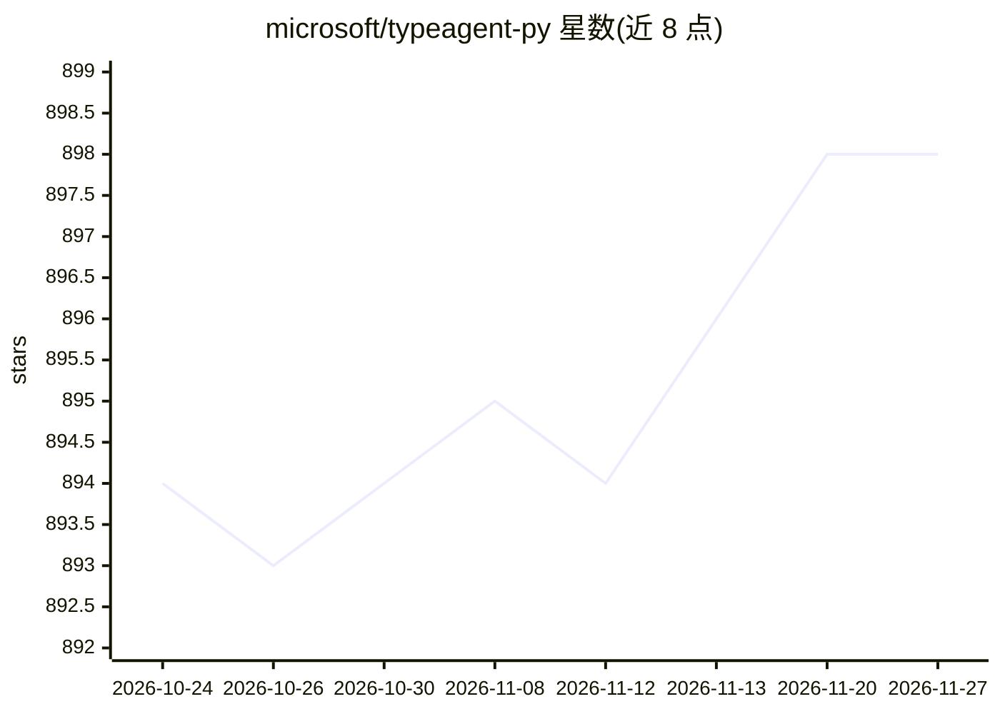

# microsoft/typeagent-py

⭐ 898 · Python · MIT · 推送 2026-11-14 · [GitHub](https://github.com/microsoft/typeagent-py) · 组织维护

**面向开发者的结构化 RAG Python 库：摄入、索引、查询**

微软 TypeAgent KnowPro 从 TypeScript 到 Python 的进行中翻译，以实验性原型和示例代码形式提供，目标是形成结构化 RAG MVP 的共同理解。通过 pip 安装，要求 Python 3.13+，文档位于 docs 目录，并附 PyBay '25 的幻灯片与视频。README 明确警告：该库会把输入发送到第三方托管的 LLM，不应索引导机密信息。

## 筛选速览

| 维度 | 判定 | 备注 |
|---|---|---|
| AI 角色 | `ai-ecosystem` | LLM/agent 周边工具 |
| 许可风险 | `permissive` | MIT |
| 部署形态 | `library` | 以包/库形式分发 |
| 模型依赖 | — | README 未给出锁定关系 |
| 硬件要求 | — | 无带数字的原话,不猜 |
| 安装摩擦 | `low` | 无编译、无系统依赖或容器化 |
| 成熟度 | `idea` | |

## 能力要点

- TypeAgent KnowPro 的 Pythonic 翻译（进行中）
- pip install typeagent 快速安装，要求 Python 3.13+
- 库会将输入发送到第三方托管的 LLM（README 明确警告）
- 提供 PyBay '25 幻灯片（PPT/PDF）与视频

## 适用场景

- 探索结构化 RAG 的 MVP 设计与实现方式
- 以 Python 使用 TypeAgent KnowPro 的相关功能
- 试点阶段处理非机密数据的索引与查询实验

## 场景标签

`RAG` · 领域:知识与检索

## 证据(README 行号)

> L5: Working toward a shared understanding of the MVP for structured RAG.
> L9: This is an in-progress project aiming at a Pythonic translation of
> L15: This library will send its input to an LLM hosted by a third party.

## 星数曲线

2026-10-24 894 → 2026-11-27 898（+4）

---
*卡片 v1 · prompt 1.4 · 生成 2026-11-24 · 置信度 high · 依据 README sha `622adf49b16f` · [字段定义](../../DATASET.md)*
