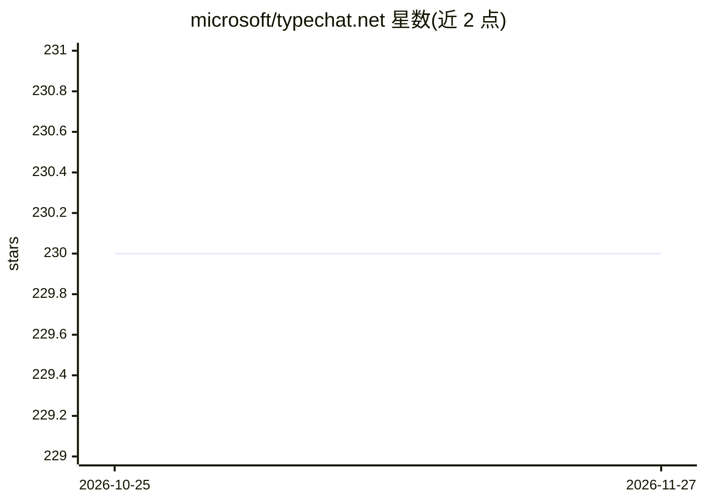

# microsoft/typechat.net

⭐ 230 · C# · MIT · 推送 2026-11-24 · [GitHub](https://github.com/microsoft/typechat.net) · 组织维护

**帮助 .NET 开发者用强类型构建自然语言界面库**

TypeChat.NET 提供跨平台 .NET 库，借助语言模型把用户自然语言意图翻译为符合 schema 的强类型 JSON 对象，经校验、反序列化后使用；校验错误回传模型进行修复。包含三个程序集：核心 JSON 翻译与校验、JSON 程序（Plan）的解释与编译、以及与 Semantic Kernel 的集成。要求 .NET SDK 8+，当前处于活跃开发阶段，包为 preview 版，schema 仅测试过 TypeScript 形式。

## 筛选速览

| 维度 | 判定 | 备注 |
|---|---|---|
| AI 角色 | `ai-ecosystem` | LLM/agent 周边工具 |
| 许可风险 | `permissive` | MIT |
| 部署形态 | `None` |  |
| 模型依赖 | locked-api |  |
| 硬件要求 | — | 无带数字的原话,不猜 |
| 安装摩擦 | `medium` | 含编译或系统依赖之一 |
| 成熟度 | `idea` | |

## 能力要点

- JSON 翻译、校验、修复与反序列化流程
- JSON 程序（Plans）支持解释器运行或 DLR 编译为 .NET 代码
- Schema 导出使用 TypeScript 表达，含依赖与基类
- 与 Microsoft Semantic Kernel 1.0 集成

## 适用场景

- 为 .NET 应用添加自然语言到结构化操作的转换
- 把用户指令转成可校验、可执行的 JSON 计划程序
- 构建带交互历史的强类型对话 agent

## 场景标签

`Agent 框架` `代码生成` · 领域:Agent 开发

## 证据(README 行号)

> L7: TypeChat.NET provides **cross platform** libraries that help you build natural language interfaces with language mod
> L90: TypeChat.Program translates natural language requests into simple programs (***Plans***), represented as JSON.
> L108: TypeChat.SemanticKernel uses Semantic Kernel 1.0. It includes classes for:

## 星数曲线

2026-10-25 230 → 2026-11-27 230（+0）

---
*卡片 v1 · prompt 1.4 · 生成 2026-11-25 · 置信度 high · 依据 README sha `d71ba20517b5` · [字段定义](../../DATASET.md)*
