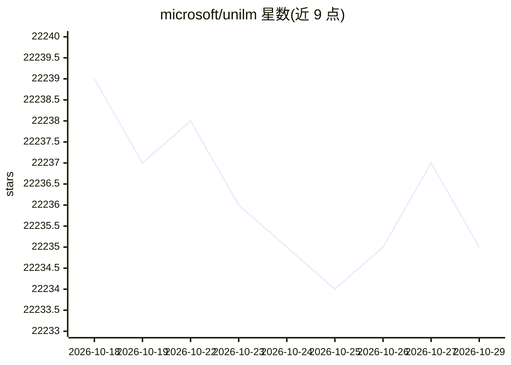

# microsoft/unilm

⭐ 22,235 · Python · MIT · 推送 2026-09-21 · [GitHub](https://github.com/microsoft/unilm) · [官网](https://aka.ms/GeneralAI) · 组织维护

**微软研究院的大规模自监督预训练模型与工具汇总库**

微软研究院维护的统一入口仓库，汇总其团队在跨任务、跨语言（100+语言）、跨模态（文本、图像、语音、文档版式）方向的自监督预训练研究成果：涵盖 UniLM、BEiT/BEiT-3、LayoutLM 系列、WavLM、VALL-E、Kosmos 系列、E5 等模型，以及 TorchScale 基础架构库、s2s-ft 微调工具包与 TrOCR 等应用。每个模型指向各自的子仓库/发布页，README 本身以目录与新闻列表为主，未提供统一安装步骤；许可需查看根目录 LICENSE 文件。

## 筛选速览

| 维度 | 判定 | 备注 |
|---|---|---|
| AI 角色 | `ai-native` | 本体是模型或模型工具 |
| 许可风险 | `permissive` | MIT |
| 部署形态 | `None` |  |
| 模型依赖 | — | README 未给出锁定关系 |
| 硬件要求 | — | 无带数字的原话,不猜 |
| 安装摩擦 | `low` | 无编译、无系统依赖或容器化 |
| 成熟度 | — | 结构信号不足 |

## 动量与使用信号

- 维护:`active` — 距上次 push 27.2 天,年发版 0,62 位贡献者
- 涨星:近 1 天 **+1**(自 20261016 起算)

## 能力要点

- 汇总数十个跨语言、视觉、语音与多模态预训练模型及其子仓库入口
- 包含 LayoutLM/LayoutXLM 文档 AI 模型与 TrOCR、LayoutReader 等应用
- 提供 TorchScale 基础架构库与 s2s-ft 微调工具包
- 发布历史记录各模型在 HuggingFace 等平台的模型发布

## 适用场景

- 查找微软研究院各类预训练模型（文档理解、语音、多模态）的官方入口
- 了解自监督预训练研究脉络与各模型的发布时间线
- 为文档 AI、OCR、TTS 等任务定位对应的模型资源

## 场景标签

`模型训练` `精选清单` · 领域:学习与行业

## 证据(README 行号)

> L38: **The Big Convergence** - Large-scale self-supervised pre-training across ```tasks``` (predictive and generative), 
> L5: # Foundation Architecture

## 星数曲线



2026-10-18 22,239 → 2026-10-29 22,235（-4）


---
*卡片 v1 · prompt 1.4 · 生成 2026-10-18 · 置信度 high · 依据 README sha `d33576eeaf3e` · [字段定义](../../DATASET.md)*
