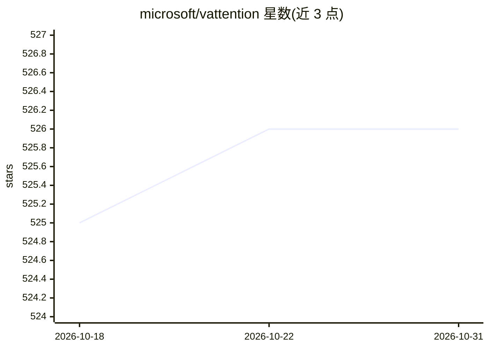

# microsoft/vattention

⭐ 526 · C · MIT · 推送 2026-08-24 · [GitHub](https://github.com/microsoft/vattention) · 组织维护

**LLM 推理服务的 KV-cache 动态内存管理器，替代 PagedAttention**

基于 CUDA 虚拟内存 API 解耦 KV-cache 的虚拟/物理内存分配，使未经修改的注意力核（FlashAttention/FlashInfer）也能获得按需物理内存分配，保持虚拟地址连续。实现与 Sarathi-Serve 推理系统集成，提供 benchmark-runner、OpenAI 兼容 API 与 Python 内存管理 API。依赖 PyTorch 2.3.0 与 CUDA 12.1，测试环境为 A100 GPU、Linux、Python 3.10；小于 2MB 页需替换定制 UVM 驱动。

## 筛选速览

| 维度 | 判定 | 备注 |
|---|---|---|
| AI 角色 | `ai-ecosystem` | LLM/agent 周边工具 |
| 许可风险 | `permissive` | MIT |
| 部署形态 | `None` |  |
| 模型依赖 | — | README 未给出锁定关系 |
| 硬件要求 | — | 无带数字的原话,不猜 |
| 安装摩擦 | `medium` | 含编译或系统依赖之一 |
| 成熟度 | — | 结构信号不足 |

## 能力要点

- CUDA 虚拟内存 API 实现按需物理页分配，KV-cache 虚拟地址连续
- 支持 FlashAttention 与 FlashInfer 后端，无需重写注意力核
- 提供 OpenAI 兼容 API 与可复现论文结果的基准脚本
- 暴露 init_kvcache/step_async 等 Python API 供服务系统集成

## 适用场景

- LLM 服务系统中替代 PagedAttention 做 KV-cache 内存管理
- 复现 prefill-bound 负载下的论文基准结果
- 用 metron 等工具通过 OpenAI 兼容端点做推理性能评测

## 场景标签

`推理引擎` · 领域:训练与推理

## 证据(README 行号)

> L3: vAttention is a memory manager for KV-cache in LLM serving systems. It decouples the allocation of virtual memory an
> L97: vAttention exports a set of simple APIs that a serving system can use for KV-cache related memory management. We ch

## 星数曲线

2026-10-18 525 → 2026-10-31 526（+1）

---
*卡片 v1 · prompt 1.4 · 生成 2026-10-21 · 置信度 high · 依据 README sha `5474a8b6ee60` · [字段定义](../../DATASET.md)*
