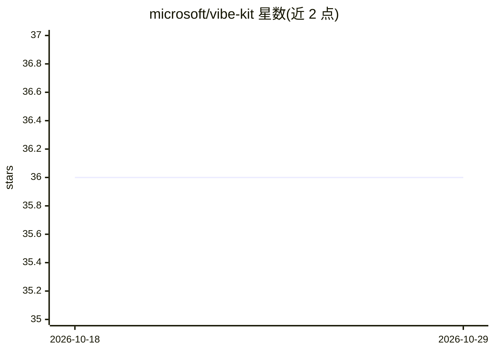

# microsoft/vibe-kit

⭐ 36 · Python · NOASSERTION · 推送 2026-05-20 · [GitHub](https://github.com/microsoft/vibe-kit) · 组织维护

**微软研究院 AI 编程助手技能合集（6 项）**

微软研究院维护的 Agent Skills 集合：以 SKILL.md 格式提供可被 AI 编程助手（GitHub Copilot、Claude 等）加载的领域技能，覆盖天气预测基础模型 Aurora、材料晶体生成 MatterGen、蛋白质构象生成 BioEmu、蛋白质序列生成 Dayhoff，以及结构化提示中间件 Promptions 等 6 项研究方向。每个技能目录含文档、示例数据与参考实现，通过 npx skills add 命令安装。

## 筛选速览

| 维度 | 判定 | 备注 |
|---|---|---|
| AI 角色 | `ai-knowledge` | 知识聚合/清单类 |
| 许可风险 | `none` | NOASSERTION |
| 部署形态 | `library` | 以包/库形式分发 |
| 模型依赖 | — | README 未给出锁定关系 |
| 硬件要求 | — | 无带数字的原话,不猜 |
| 安装摩擦 | `low` | 无编译、无系统依赖或容器化 |
| 成熟度 | — | 结构信号不足 |

## 能力要点

- 6 个微软研究院项目技能，含 SKILL.md 激活条件
- 覆盖天气预测、材料生成、蛋白质建模等研究方向
- 每个技能附文档、工作示例与参考实现
- npx skills add 一条命令安装到 AI 助手

## 适用场景

- 让 GitHub Copilot/Claude 学会调用 Aurora 等研究项目
- 在编程助手中集成微软研究院的工作流与示例
- 了解各研究方向技能的结构与用法

## 场景标签

 · 领域:科研/AI 编程助手技能

## 证据(README 行号)

> L7: This repository hosts **Microsoft Research Agent Skills** — drop-in skills for AI assistants like GitHub Copilot and
> L35: npx skills add microsoft/vibe-kit/skills/name-of-skill

## 星数曲线

2026-10-18 36 → 2026-10-29 36（+0）

---
*卡片 v1 · prompt 1.4 · 生成 2026-10-25 · 置信度 high · 依据 README sha `a6453b7e85b1` · [字段定义](../../DATASET.md)*
