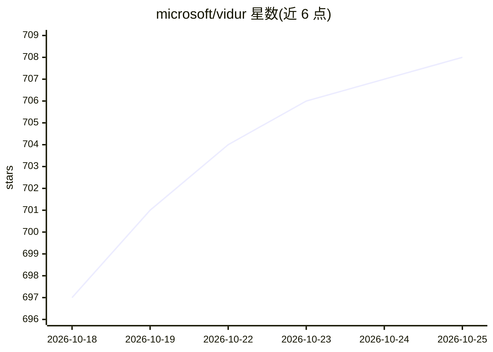

# microsoft/vidur

⭐ 709 · Python · MIT · 推送 2026-08-24 · [GitHub](https://github.com/microsoft/vidur) · 组织维护

**面向 LLM 推理系统的性能模拟器，用于容量规划与配置搜索**

微软维护的 LLM 推理系统仿真器：通过短暂的初始 profiling 阶段后，可在无 GPU 环境下模拟不同模型、负载与部署配置的系统性能，输出 TTFT、TPOT、请求端到端时间与 batch size 等指标，支持配置搜索以按容量/成本挑选部署方案，并可测试新调度算法或 speculative decoding 等研究想法。支持 A100/H100 等多种设备 SKU 与 TP/PP 并行组合，输出记录到 wandb 与 Chrome trace。给推理系统工程师与研究人员使用。

## 筛选速览

| 维度 | 判定 | 备注 |
|---|---|---|
| AI 角色 | `ai-ecosystem` | LLM/agent 周边工具 |
| 许可风险 | `permissive` | MIT |
| 部署形态 | `library` | 以包/库形式分发 |
| 模型依赖 | — | README 未给出锁定关系 |
| 硬件要求 | — | 无带数字的原话,不猜 |
| 安装摩擦 | `low` | 无编译、无系统依赖或容器化 |
| 成熟度 | — | 结构信号不足 |

## 能力要点

- 无需 GPU（除初始 profiling）即可模拟推理系统性能
- 覆盖 A100/H100 等设备 SKU 与 TP/PP 任意组合的并行模拟
- 输出 TTFT/TPOT/E2E 等指标到 wandb 与 Chrome trace
- 提供配置搜索用于容量规划与容量/成本权衡

## 适用场景

- 上线前做 LLM 部署的容量规划与配置搜索
- 研究新调度算法或 speculative decoding 等优化
- 比较不同硬件 SKU 与并行策略下的推理延迟指标

## 场景标签

 · 领域:LLM 基础设施/仿真

## 证据(README 行号)

> L3: Vidur is a high-fidelity and extensible LLM inference system simulator. It can help you with:
> L18: ... all without access to GPUs except for a quick initial profiling phase 🎉. We highly recommend checking out our M

## 星数曲线

2026-10-18 697 → 2026-10-25 708（+11）

---
*卡片 v1 · prompt 1.4 · 生成 2026-10-21 · 置信度 mid · 依据 README sha `6257fc414074` · [字段定义](../../DATASET.md)*
