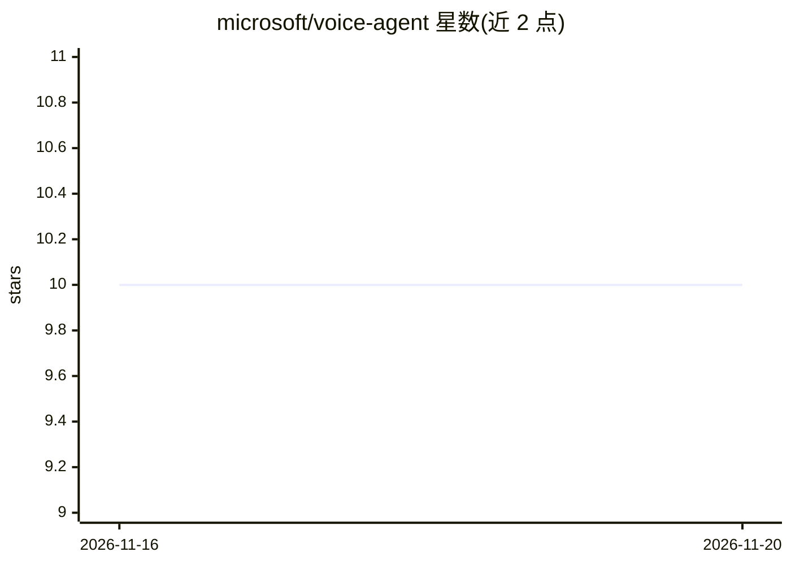

# microsoft/voice-agent

⭐ 10 · JavaScript · NOASSERTION · 推送 2026-11-19 · [GitHub](https://github.com/microsoft/voice-agent) · [官网](https://learn.microsoft.com/en-us/azure/foundry/agents/quickstarts/prompt-voice-agent?pivots=portal) · 组织维护

**开发者在 Foundry Agent Service 上构建语音 agent 的社区中心**

微软 Foundry Agent Service 中 Voice Agent 功能的官方社区仓库，汇集问题反馈入口、文档/视频/博客链接、可运行样例与本地 Portal。Voice Agent 基于 Voice Live 实时语音能力，叠加 agent 管理、工具编排、知识接入与可观测性。支持 speech-to-speech 与级联（STT→LLM→TTS）两种管线，模型可选 OpenAI GPT Realtime/GPT Live、Azure 语音与 MAI 系列，并通过 Teams 与 Twilio 接入呼入呼出电话。提供 Python/Java/JS/C# SDK。README 同时存在 GA 与 public preview 两种表述。

## 筛选速览

| 维度 | 判定 | 备注 |
|---|---|---|
| AI 角色 | `ai-ecosystem` | LLM/agent 周边工具 |
| 许可风险 | `none` | NOASSERTION |
| 部署形态 | `None` |  |
| 模型依赖 | — | README 未给出锁定关系 |
| 硬件要求 | — | 无带数字的原话,不猜 |
| 安装摩擦 | `low` | 无编译、无系统依赖或容器化 |
| 成熟度 | — | 结构信号不足 |

## 能力要点

- 支持 speech-to-speech 与级联 STT→LLM→TTS 两种管线
- 提供 Python、Java、JavaScript/TypeScript、C#/.NET 四种 SDK
- 本地 Portal 运行于 127.0.0.1:9527，含模板示例与 mock MCP 工具调用
- 支持 Teams/Twilio 电话接入与自定义语音、头像

## 适用场景

- 构建呼叫中心的实时语音 agent
- 从 Voice Live 直连 LLM 迁移到托管的 Voice Agent
- 在 Teams 会议中接入语音 agent 与虚拟形象

## 场景标签

`语音 Agent` · 领域:对话与助手

## 证据(README 行号)

> L4: > Build and launch an enterprise-ready voice agent in under two minutes. Choose speech-to-speech or cascaded pipelin
> L6: This repository is the official community hub for Voice Agent in Foundry Agent Service. Here you'll find:
> L20: Voice Live is the foundation for real-time voice interaction, and Voice Agent builds on that foundation to deliver 

## 星数曲线

2026-11-16 10 → 2026-11-20 10（+0）

---
*卡片 v1 · prompt 1.4 · 生成 2026-11-19 · 置信度 mid · 依据 README sha `08f3bca83d3b` · [字段定义](../../DATASET.md)*
