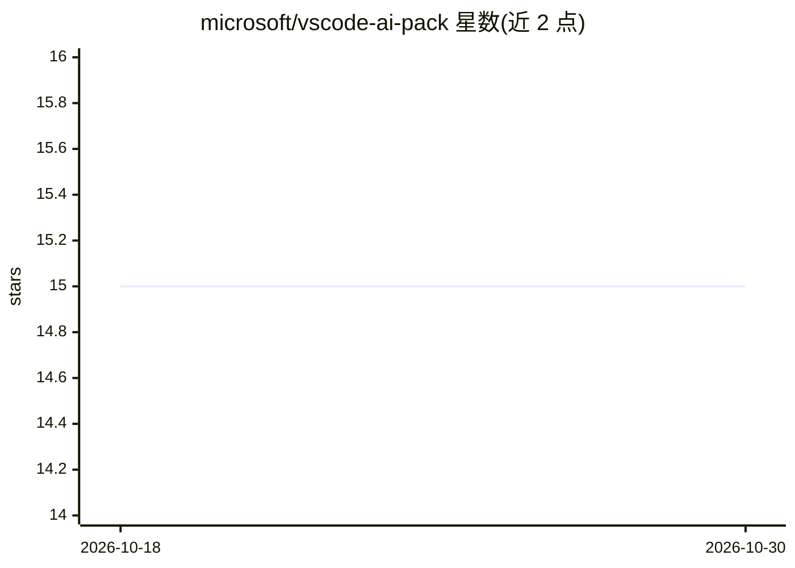

# microsoft/vscode-ai-pack

⭐ 15 · MIT · 推送 2025-11-07 · [GitHub](https://github.com/microsoft/vscode-ai-pack) · 组织维护

**微软官方 VS Code AI 开发扩展合集（含 5 个扩展）**

由 Microsoft 维护的 VS Code 扩展包，聚合 5 个用于构建生成式 AI 应用与 agent 的扩展：AI Toolkit（本地与远程生成式模型的探索与 agent 创建）、Azure AI Foundry（模型与 agent 管理及部署到 Azure）、GitHub Copilot、GitHub Copilot for Azure（云端开发增强）、Data Wrangler（数据准备与转换）。定位是加速从模型探索、数据转换到本地 agent 开发与 Azure 部署的工作流，通过 VS Code 扩展市场安装。

## 筛选速览

| 维度 | 判定 | 备注 |
|---|---|---|
| AI 角色 | `ai-ecosystem` | LLM/agent 周边工具 |
| 许可风险 | `permissive` | MIT |
| 部署形态 | `None` |  |
| 模型依赖 | — | README 未给出锁定关系 |
| 硬件要求 | — | 无带数字的原话,不猜 |
| 安装摩擦 | `low` | 无编译、无系统依赖或容器化 |
| 成熟度 | — | 结构信号不足 |

## 能力要点

- 聚合 5 个 AI 开发相关 VS Code 扩展
- 覆盖本地模型探索、agent 开发与 Azure 部署
- 包含数据准备工具 Data Wrangler

## 适用场景

- 在 VS Code 中一站式安装 AI 应用开发工具集
- 使用 AI Toolkit 在本地探索和创建 AI agent
- 将开发的模型与 agent 部署到 Azure

## 场景标签

`Agent 框架` · 领域:Agent 开发

## 证据(README 行号)

> L3: The **Microsoft AI Tools Extension Pack** is a curated set of essential extensions for building generative AI applic
> L7: - AI Toolkit: A comprehensive set of tools for exploring and creating AI agents with local and remote generative AI 

## 星数曲线

2026-10-18 15 → 2026-10-30 15（+0）

---
*卡片 v1 · prompt 1.4 · 生成 2026-10-30 · 置信度 high · 依据 README sha `4d97ee5ad767` · [字段定义](../../DATASET.md)*
