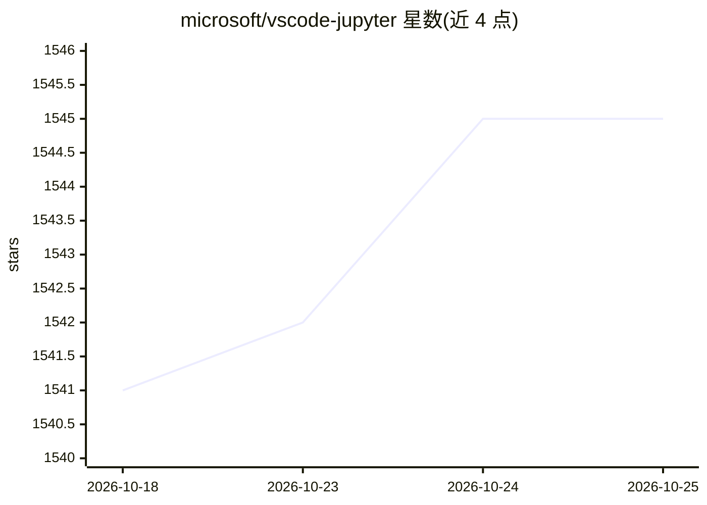

# microsoft/vscode-jupyter

⭐ 1,545 · TypeScript · MIT · 推送 2026-10-21 · [GitHub](https://github.com/microsoft/vscode-jupyter) · [官网](https://marketplace.visualstudio.com/items?itemName=ms-toolsai.jupyter) · 组织维护

**VS Code 的 Jupyter 笔记本扩展：编辑与运行多语言内核笔记本**

微软维护的 Visual Studio Code 扩展，为 Jupyter 支持的语言内核提供笔记本编辑与运行支持，允许任意 Python 环境充当 Jupyter 内核（本体不是内核，需自行安装含 Jupyter 包的 Python 环境）。支持 Julia、R、C# 等其他语言内核，提供内核选择、单元格运行、IntelliSense、导出 HTML/PDF 等功能，可在 vscode.dev 与 GitHub Codespaces 的浏览器中使用，并自动附带四个子扩展。面向使用 VS Code 的数据科学与开发用户。

## 筛选速览

| 维度 | 判定 | 备注 |
|---|---|---|
| AI 角色 | `ai-ecosystem` | LLM/agent 周边工具 |
| 许可风险 | `permissive` | MIT |
| 部署形态 | `None` |  |
| 模型依赖 | — | README 未给出锁定关系 |
| 硬件要求 | — | 无带数字的原话,不猜 |
| 安装摩擦 | `low` | 无编译、无系统依赖或容器化 |
| 成熟度 | — | 结构信号不足 |

## 能力要点

- 支持 Jupyter 各语言内核并允许任意 Python 环境作为内核
- 支持 Julia、R、C# 等非 Python 语言内核
- 可在 vscode.dev 与 GitHub Codespaces 浏览器环境使用
- 提供 IntelliSense、单元格标签、导出 HTML/PDF 与 14 种本地化语言

## 适用场景

- 在 VS Code 中创建、编辑并运行 Jupyter 笔记本
- 把本机 Anaconda/Miniconda 等 Python 环境直接选作内核
- 在浏览器或 Codespaces 中继续编辑笔记本
- 导出笔记本为 HTML 或 PDF 用于展示

## 场景标签

 · 领域:开发工具/数据科学

## 证据(README 行号)

> L3: A Visual Studio Code extension that provides basic notebook support for language kernels that are supported in Jupyt
> L41: The Jupyter Extension supports other languages in addition to Python such as Julia, R, and C#.

## 星数曲线

2026-10-18 1,541 → 2026-10-25 1,545（+4）

---
*卡片 v1 · prompt 1.4 · 生成 2026-10-21 · 置信度 low · 依据 README sha `2f18f669ce39` · [字段定义](../../DATASET.md)*
