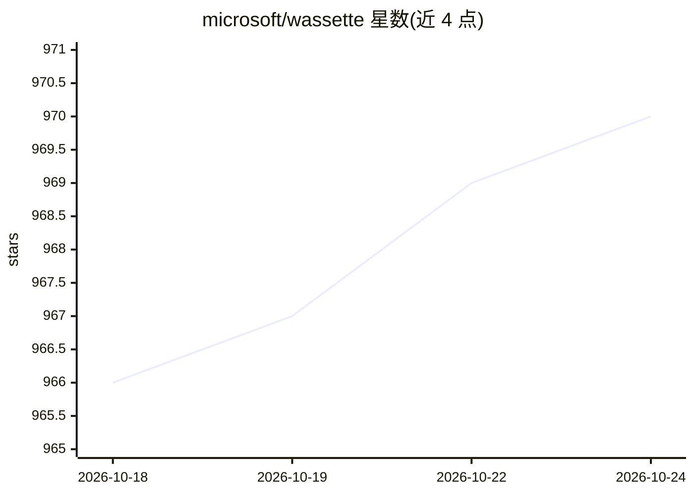

# microsoft/wassette

⭐ 970 · Rust · MIT · 推送 2026-10-20 · [GitHub](https://github.com/microsoft/wassette) · [官网](https://microsoft.github.io/wassette/) · 组织维护

**通过 MCP 安全运行 WebAssembly 组件的工具运行时**

微软开源的面向安全的运行时，将 WebAssembly 组件作为工具接入 AI agent：基于 Wasmtime 安全沙箱提供浏览器级隔离，组件本身与 MCP 无关、可复用。agent 通过对话加载 OCI 注册表中的 wasm 组件（如 ghcr.io 上的 time-server）并调用其能力。安装提供 Linux/macOS 一行脚本，另支持 Windows、Homebrew、Nix、Docker 等途径；可与 GitHub Copilot、Copilot CLI、Claude Code、Codex CLI 等 MCP 客户端配置使用。仓库声明处于早期开发阶段，尚未生产就绪。

## 筛选速览

| 维度 | 判定 | 备注 |
|---|---|---|
| AI 角色 | `ai-ecosystem` | LLM/agent 周边工具 |
| 许可风险 | `permissive` | MIT |
| 部署形态 | `None` |  |
| 模型依赖 | — | README 未给出锁定关系 |
| 硬件要求 | — | 无带数字的原话,不猜 |
| 安装摩擦 | `low` | 无编译、无系统依赖或容器化 |
| 成熟度 | `idea` | |

## 能力要点

- 基于 Wasmtime 沙箱运行 Wasm 组件，提供浏览器级工具隔离
- 通过 MCP 协议向 agent 暴露组件能力，支持从 OCI 注册表加载
- 组件与 MCP 解耦，通用可复用

## 适用场景

- 为 AI agent 安全地挂载可复用的工具组件
- 在受控沙箱中运行来自 OCI 注册表的第三方工具
- 扩展 Copilot、Claude Code 等 MCP 客户端的工具能力

## 场景标签

 · 领域:AI 基础设施/agent 工具运行时

## 证据(README 行号)

> L2:  A security-oriented runtime that runs WebAssembly Components via MCP
> L34: With Wassette installed, the next step is to register it with your agent of choice. See our [Quick Start] guide (3 
> L15: - **Security**: Wassette is built on the Wasmtime security sandbox, providing

## 星数曲线

2026-10-18 966 → 2026-10-24 970（+4）

---
*卡片 v1 · prompt 1.4 · 生成 2026-10-21 · 置信度 high · 依据 README sha `f81eb0ca2486` · [字段定义](../../DATASET.md)*
