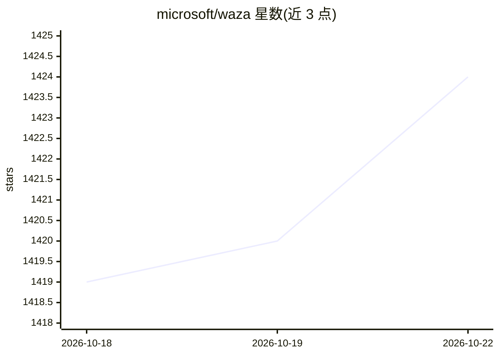

# microsoft/waza

⭐ 1,425 · Go · MIT · 推送 2026-10-22 · [GitHub](https://github.com/microsoft/waza) · [官网](https://microsoft.github.io/waza/) · 组织维护

**评估 agent 技能与工作流的 Go CLI：创建、测试、度量技能质量**

面向 agent 技能开发者的评估工具链：以 SKILL.md 定义技能，用 waza new 生成技能与评估套件脚手架，通过 preflight（离线静态检查）、run、grade、gate 等命令执行带评分的试运行并检查证据，支持 repository/CLI/MCP 三类场景模板、CI 回归门禁与 opt-in 仪表盘 Lab。执行器包含 copilot-sdk（捆绑 GitHub Copilot CLI）与 mock；README 明确 mock 只验证框架本身而非 agent 质量。提供二进制安装脚本、azd 扩展与源码构建（需 Go/Make/Node/npm）三种安装方式。

## 筛选速览

| 维度 | 判定 | 备注 |
|---|---|---|
| AI 角色 | `ai-ecosystem` | LLM/agent 周边工具 |
| 许可风险 | `permissive` | MIT |
| 部署形态 | `desktop` | 安装包/桌面程序 |
| 模型依赖 | — | README 未给出锁定关系 |
| 硬件要求 | — | 无带数字的原话,不猜 |
| 安装摩擦 | `low` | 无编译、无系统依赖或容器化 |
| 成熟度 | — | 结构信号不足 |

## 能力要点

- waza init/new 脚手架生成技能定义与评估套件，含 CI/CD 工作流
- preflight 离线无 agent 检查 schema、任务 ID、grader 配置
- repository/cli/mcp 三类场景模板与带评分的试运行
- 捆绑 GitHub Copilot CLI 的 copilot-sdk 执行器，另有 mock 执行器

## 适用场景

- 为 agent 技能编写评估套件并度量有效性
- 在 CI 中对技能改动运行回归门禁
- 离线静态校验评估配置后再执行

## 场景标签

`模型评测` · 领域:评测与运维

## 证据(README 行号)

> L3: A Go CLI for evaluating agent workflows, skills, and custom agents — author repository, CLI, and MCP scenarios, run 
> L133: ### `waza preflight <eval.yaml>`

## 星数曲线

2026-10-18 1,419 → 2026-10-22 1,424（+5）

---
*卡片 v1 · prompt 1.4 · 生成 2026-10-21 · 置信度 mid · 依据 README sha `7c7406e0f3e3` · [字段定义](../../DATASET.md)*
