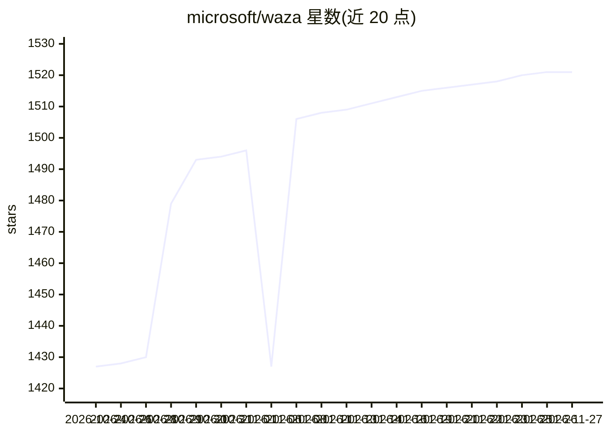

# microsoft/waza

⭐ 1,521 · Go · MIT · 推送 2026-11-25 · [GitHub](https://github.com/microsoft/waza) · [官网](https://microsoft.github.io/waza/) · 组织维护

**给开发者测试与评估 AI agent 工作流的 Go CLI**

微软开源的 Go 语言命令行工具，用于为技能、提示词、agent 工作流和自定义 agent 编写场景，运行带评分的试验并查看证据，支持 CI 回归门禁。机制上提供固定工作区隔离、检查点与可恢复执行、执行溯源与 OpenTelemetry 遥测导出，以及独立的 azd 扩展分发形式。版本边界声明了已发布二进制与源码行为可能不一致；产品使用遥测默认开启但可用环境变量或配置关闭。

## 筛选速览

| 维度 | 判定 | 备注 |
|---|---|---|
| AI 角色 | `ai-ecosystem` | LLM/agent 周边工具 |
| 许可风险 | `permissive` | MIT |
| 部署形态 | `desktop` | 安装包/桌面程序 |
| 模型依赖 | — | README 未给出锁定关系 |
| 硬件要求 | — | 无带数字的原话,不猜 |
| 安装摩擦 | `medium` | 含编译或系统依赖之一 |
| 成熟度 | `idea` | |

## 能力要点

- 可重复场景 + 评分器 + 证据的 agent 评估，支持 CI 集成
- 检查点创建/恢复与执行 lineage 记录（v0.41.0+）
- runner telemetry 导出 OTLP/JSON 或发送至 OTLP/HTTP 收集器
- 提供二进制安装脚本、源码构建与 azd 扩展三种分发方式

## 适用场景

- 为 agent 工作流建立可重复的评估场景与回归门禁
- 在 CI 中拦截 agent 行为退化
- 审计每次评估运行的执行证据与遥测数据

## 场景标签

`模型评测` · 领域:评测与运维

## 证据(README 行号)

> L3: A Go CLI for evaluating skills, prompts, agent workflows, and custom agents — author repository, CLI, and MCP scenar
> L17: → CI regression gates.

## 星数曲线

2026-10-24 1,427 → 2026-11-27 1,521（+94）

---
*卡片 v1 · prompt 1.4 · 生成 2026-11-26 · 置信度 high · 依据 README sha `49085fc37db6` · [字段定义](../../DATASET.md)*
