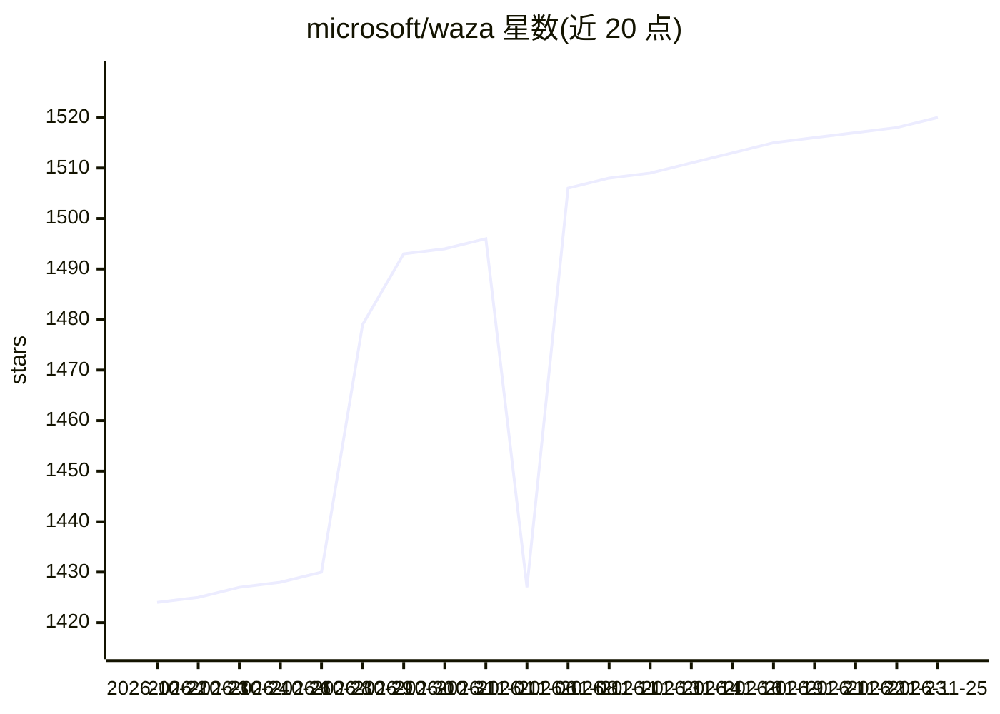

# microsoft/waza

⭐ 1,520 · Go · MIT · 推送 2026-11-24 · [GitHub](https://github.com/microsoft/waza) · [官网](https://microsoft.github.io/waza/) · 组织维护

**微软出品的 agent 工作流评测 CLI：可重复场景、评分与 CI 集成**

Go 编写的 CLI，用于测试与评估 agent 工作流、自定义 agent 与技能：编写仓库/CLI/MCP 场景，运行带评分（grader）与证据（evidence）的试验，并集成 CI 回归门禁。每个任务使用独立复制的隔离工作区；支持 checkpoint 恢复、执行溯源与血缘记录、OpenTelemetry 导出，以及通过 azd 扩展或可选 Lab 仪表盘使用。默认收集可关闭的产品遥测；评估结果保留在本地。发布为预构建二进制，也可从源码构建。

## 筛选速览

| 维度 | 判定 | 备注 |
|---|---|---|
| AI 角色 | `ai-ecosystem` | LLM/agent 周边工具 |
| 许可风险 | `permissive` | MIT |
| 部署形态 | `desktop` | 安装包/桌面程序 |
| 模型依赖 | — | README 未给出锁定关系 |
| 硬件要求 | — | 无带数字的原话,不猜 |
| 安装摩擦 | `medium` | 含编译或系统依赖之一 |
| 成熟度 | — | 结构信号不足 |

## 能力要点

- 可重复场景 + grader 评分 + 证据留存，支持 CI 回归门禁
- 任务级隔离工作区（复制 fixture，不修改原件）
- checkpoint 创建/恢复与执行尝试血缘、OTLP 遥测导出
- 支持 azd 扩展安装与编码 agent 辅助编写评测

## 适用场景

- 为 agent 工作流建立可重复的回归评测
- 在 CI 中用评分结果做合并门禁
- 审计 agent 运行的证据与执行血缘

## 场景标签

`模型评测` · 领域:评测与运维

## 证据(README 行号)

> L3: A Go CLI for evaluating agent workflows, skills, and custom agents — author repository, CLI, and MCP scenarios, run 
> L17: → CI regression gates.

## 星数曲线

2026-10-22 1,424 → 2026-11-25 1,520（+96）

---
*卡片 v1 · prompt 1.4 · 生成 2026-11-24 · 置信度 high · 依据 README sha `76531c50356a` · [字段定义](../../DATASET.md)*
