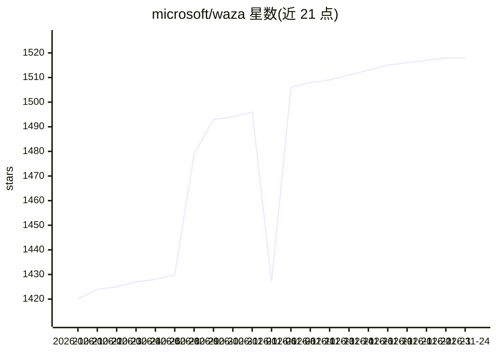

# microsoft/waza

⭐ 1,518 · Go · MIT · 推送 2026-11-22 · [GitHub](https://github.com/microsoft/waza) · [官网](https://microsoft.github.io/waza/) · 组织维护

**面向开发者的 AI agent 工作流评测 CLI：可复现场景、评分与证据**

微软出品的 Go 命令行工具，用于对 agent 工作流、技能与自定义 agent 做评测：编写仓库/CLI/MCP 场景，运行带评分器的分级试验，收集证据并接入 CI 回归门禁。提供安装脚本、waza update 自更新与可选源码构建；另有 azd 扩展分发形式。内置执行溯源、checkpoint 恢复、聚合与 OTLP 遥测导出等机制；发布版本默认开启产品使用遥测，可通过多种方式关闭。Mock 结果仅验证测试框架本身，不代表真实 agent 质量。

## 筛选速览

| 维度 | 判定 | 备注 |
|---|---|---|
| AI 角色 | `ai-ecosystem` | LLM/agent 周边工具 |
| 许可风险 | `permissive` | MIT |
| 部署形态 | `desktop` | 安装包/桌面程序 |
| 模型依赖 | — | README 未给出锁定关系 |
| 硬件要求 | — | 无带数字的原话,不猜 |
| 安装摩擦 | `medium` | 含编译或系统依赖之一 |
| 成熟度 | — | 结构信号不足 |

## 能力要点

- 可复现评测场景 + 评分器 + 证据留存的 CLI 评测框架
- CI 回归门禁与 azd 扩展两种集成方式
- checkpoint 创建/恢复与执行 lineage、OTLP 遥测导出
- 自动版本检查与 waza update 自更新

## 适用场景

- 为 agent 工作流建立可重复的评测与回归基线
- 在 CI 中加入评测门禁防止 agent 行为回退
- 用 agent 辅助编写与维护评测规格

## 场景标签

`模型评测` · 领域:评测与运维

## 证据(README 行号)

> L3: A Go CLI for evaluating agent workflows, skills, and custom agents — author repository, CLI, and MCP scenarios, run 
> L17: → CI regression gates.

## 星数曲线

2026-10-21 1,420 → 2026-11-24 1,518（+98）

---
*卡片 v1 · prompt 1.4 · 生成 2026-11-23 · 置信度 high · 依据 README sha `18b50d2cb7e0` · [字段定义](../../DATASET.md)*
