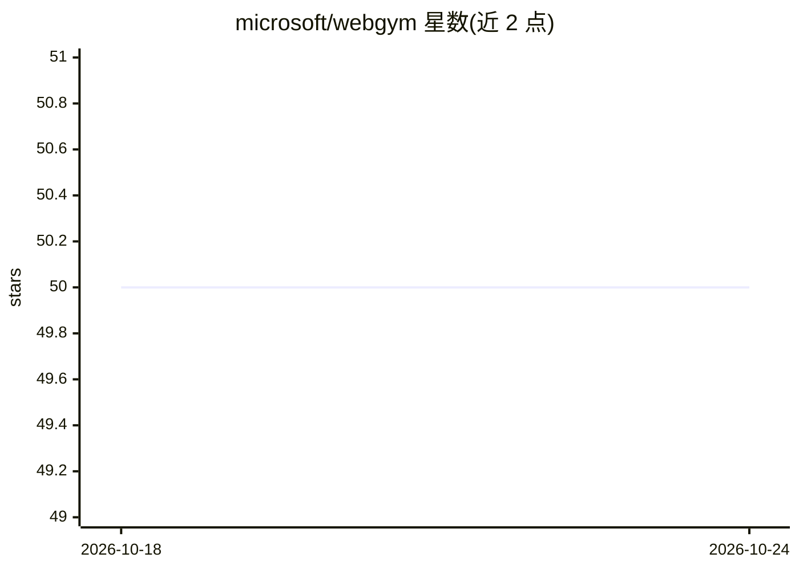

# microsoft/webgym

⭐ 50 · Python · NOASSERTION · 推送 2026-06-09 · [GitHub](https://github.com/microsoft/webgym) · 组织维护

**异步多步强化学习训练视觉 Web Agent 的框架**

Microsoft 与 UIUC 等机构发布的 AsyncWebRL：基于 AReaL 异步 RL 框架训练视觉-语言 Web Agent，采用常驻 rollout 池、轻量截图处理与解耦 off-policy 修正等异步机制提升训练吞吐；算法上以常数 1/k 替换多步 GRPO 的逐步归一化，缩短轨迹。组件（workflow、引擎、奖励、数据集）模块化可替换。面向有集群的 RL 研究与工程人员，安装经 Docker 镜像或本地 uv，原 WebGym 代码在 webgym 分支。

## 筛选速览

| 维度 | 判定 | 备注 |
|---|---|---|
| AI 角色 | `ai-ecosystem` | LLM/agent 周边工具 |
| 许可风险 | `permissive` | NOASSERTION |
| 部署形态 | `None` |  |
| 模型依赖 | local-ok | 支持本地模型 |
| 硬件要求 | — | 无带数字的原话,不猜 |
| 安装摩擦 | `low` | 无编译、无系统依赖或容器化 |
| 成熟度 | — | 结构信号不足 |

## 能力要点

- 常驻 rollout 池使 rollout/梯度更新/策略刷新持续重叠
- 截图张量留存专用内存 actor，仅引用走 RPC
- 以常数 1/k 替换 1/|τ| 归一化，缩短失败轨迹
- 支持 FSDP2/Megatron 训练与 SGLang/vLLM rollout，Qwen3-VL 策略

## 适用场景

- 在集群上异步 RL 训练视觉 Web Agent
- 复现或扩展多步 GRPO 的算法变体
- 基于 WebGym 评测集做 Web Agent 研究

## 场景标签

`强化学习` · 领域:训练与推理

## 证据(README 行号)

> L18: AsyncWebRL trains vision-language web agents with efficient multi-step reinforcement learning. It is built on the A
> L48: - Built on AReaL — FSDP2 / Megatron training, SGLang / vLLM rollout,
> L50: - Modular and extensible: workflows, engines, rewards, and datasets are

## 星数曲线

2026-10-18 50 → 2026-10-24 50（+0）

---
*卡片 v1 · prompt 1.4 · 生成 2026-10-24 · 置信度 high · 依据 README sha `9696eb1cf62a` · [字段定义](../../DATASET.md)*
