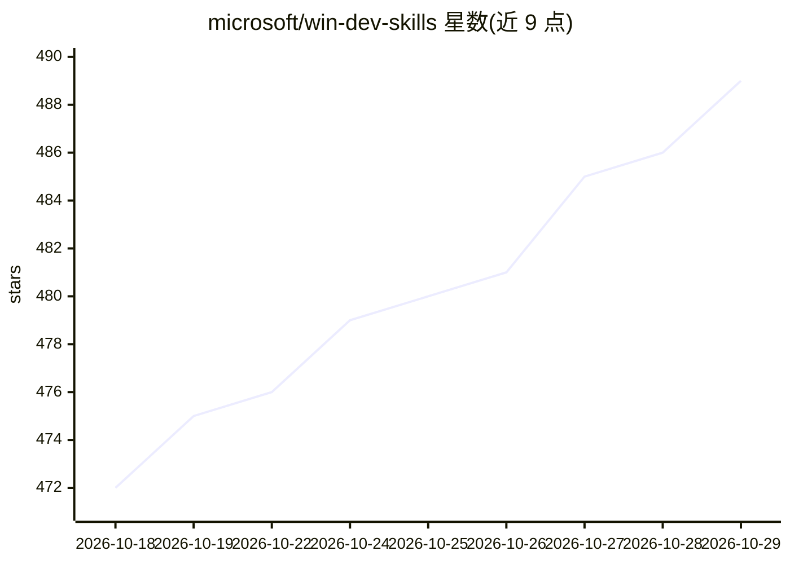

# microsoft/win-dev-skills

⭐ 489 · JavaScript · MIT · 推送 2026-10-26 · [GitHub](https://github.com/microsoft/win-dev-skills) · 组织维护

**微软维护的 Windows 开发 AI agent 插件/技能目录**

微软维护的 Windows 开发与调试 agent 插件目录，收录 winappcli（MSIX 打包/签名/分发）、winui（WinUI 3 与 Windows App SDK 开发）、windbg（WinDbg 诊断与报告校验）三个插件，其中前两个由 microsoft/winappCli 仓库维护。以 marketplace/catalog 形式供 GitHub Copilot CLI、Claude Code、OpenAI Codex 等宿主安装；OpenClaw 需从各维护仓库的 catalog 安装，OpenCode 通过克隆仓库并链接 SKILL.md 目录使用。Codex/OpenClaw/OpenCode 仅加载 skills、不加载 agents。

## 筛选速览

| 维度 | 判定 | 备注 |
|---|---|---|
| AI 角色 | `ai-knowledge` | 知识聚合/清单类 |
| 许可风险 | `permissive` | MIT |
| 部署形态 | `None` |  |
| 模型依赖 | — | README 未给出锁定关系 |
| 硬件要求 | — | 无带数字的原话,不猜 |
| 安装摩擦 | `low` | 无编译、无系统依赖或容器化 |
| 成熟度 | — | 结构信号不足 |

## 能力要点

- 收录 winappcli / winui / windbg 三个 Windows 开发插件
- 支持 Copilot CLI、Claude Code、Codex、OpenClaw、OpenCode 多宿主安装
- OpenCode 通过 git clone 加 junction 链接 SKILL.md 目录接入
- Codex/OpenClaw/OpenCode 宿主仅加载 skills，不加载 agents

## 适用场景

- 让 AI 编程助手执行 WinUI 3 应用的脚手架、构建与打包
- 为 agent 添加 MSIX 打包、签名与微软商店分发能力
- 借助 agent 进行 WinDbg 崩溃诊断与报告校验

## 场景标签

`精选清单` · 领域:学习与行业

## 证据(README 行号)

> L3: Agent plugins for Windows development and debugging—from apps and services to kernel-mode drivers—with GitHub Copilo
> L5: |Plugin|What it's for|Maintained in|Hosts|

## 星数曲线

2026-10-18 472 → 2026-10-29 489（+17）

---
*卡片 v1 · prompt 1.4 · 生成 2026-10-21 · 置信度 high · 依据 README sha `e0f99f8fe89c` · [字段定义](../../DATASET.md)*
