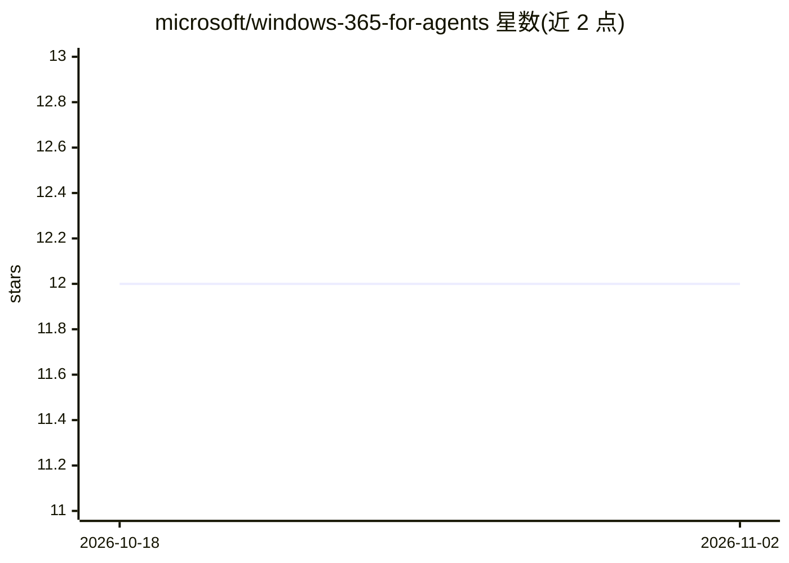

# microsoft/windows-365-for-agents

⭐ 12 · C# · NOASSERTION · 推送 2026-10-20 · [GitHub](https://github.com/microsoft/windows-365-for-agents) · 组织维护

**微软官方文档：让 AI agent 在云端 Windows PC 上执行任务**

Windows 365 for Agents 的开发者文档仓库：提供 Entra ID 加入、Intune 管理的托管云 PC 供 AI agent 运行计算机使用类任务；agent 从共享池按任务签出云 PC，通过 MCP 协议调用 65 个工具（桌面键鼠/进程/shell/浏览器/DOM/无障碍），用完归还复用。含 WebRTC 实时屏幕共享 SDK 支持人类在环观察与接管。文档 CC-BY-4.0，仓库内 Playground 示例代码（C#/.NET 10）MIT 许可。

## 筛选速览

| 维度 | 判定 | 备注 |
|---|---|---|
| AI 角色 | `ai-ecosystem` | LLM/agent 周边工具 |
| 许可风险 | `none` | NOASSERTION |
| 部署形态 | `None` |  |
| 模型依赖 | — | README 未给出锁定关系 |
| 硬件要求 | — | 无带数字的原话,不猜 |
| 安装摩擦 | `medium` | 含编译或系统依赖之一 |
| 成熟度 | — | 结构信号不足 |

## 能力要点

- 云 PC 池的签出/签入模型，agent 按能力请求而非指定机器
- 65 个 MCP 工具：3 会话管理 + 26 桌面 + 36 浏览器
- WebRTC 实时屏幕共享 SDK 支持人类在环观察与接管
- 四平面架构（Create/Get/Do/See）与 A365 工具网关（ATG）

## 适用场景

- 让 agent 在隔离的云 Windows 桌面上执行浏览器与桌面自动化任务
- 企业内以 Intune/条件访问策略治理 agent 的计算机使用环境
- 人类监督 agent 操作并随时接管

## 场景标签

`GUI 自动化` `浏览器自动化` · 领域:效率与自动化

## 证据(README 行号)

> L16: Windows 365 for Agents provides Cloud PCs for AI agent workloads — fully managed, Entra ID-joined, Intune-governed 
> L24: - 🤖 **65 MCP tools** — 3 session-management tools plus 26 desktop tools (mouse/keyboard, windows, processes, shell,

## 星数曲线

2026-10-18 12 → 2026-11-02 12（+0）

---
*卡片 v1 · prompt 1.4 · 生成 2026-11-01 · 置信度 high · 依据 README sha `0ddfefb992ff` · [字段定义](../../DATASET.md)*
