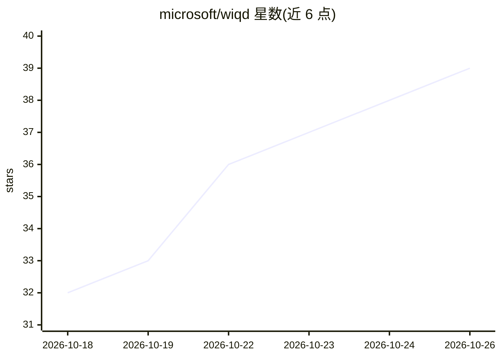

# microsoft/wiqd

⭐ 39 · PowerShell · NOASSERTION · 推送 2026-10-23 · [GitHub](https://github.com/microsoft/wiqd) · 组织维护

**微软 365 Copilot 声明式智能体的全生命周期开发工具集**

微软发布的 agentic 开发工具集，面向 Microsoft 365 Copilot 扩展开发者，覆盖声明式智能体、技能与连接器插件从脚手架创建、编辑、静态与深度校验、打包、部署、共享到评测与遥测监控的完整生命周期。主体验是加载 20 个引导式工作流的 Copilot 插件（GitHub Copilot CLI 与 VS Code Copilot Chat），每个工作流均有等价的 wiqd CLI 命令可供脚本与 CI 调用。目前为预发布实验阶段，源码暂未公开，CLI 经 npm 分发。

## 筛选速览

| 维度 | 判定 | 备注 |
|---|---|---|
| AI 角色 | `ai-ecosystem` | LLM/agent 周边工具 |
| 许可风险 | `none` | NOASSERTION |
| 部署形态 | `None` |  |
| 模型依赖 | — | README 未给出锁定关系 |
| 硬件要求 | — | 无带数字的原话,不猜 |
| 安装摩擦 | `low` | 无编译、无系统依赖或容器化 |
| 成熟度 | `idea` | |

## 能力要点

- 覆盖创建、校验、打包、部署、共享、评测、监控的全生命周期
- 20 个引导式 Copilot 工作流，均对应可自动化调用的 CLI 命令
- 内置 LSP 支持提供 VS Code 中实时 manifest 校验
- 支持 npm 扩展机制添加命令、校验提供者与健康检查

## 适用场景

- 为 Microsoft 365 Copilot 创建并发布声明式智能体
- 在 VS Code 或 Copilot CLI 中以自然语言驱动智能体开发流程
- 对已部署智能体运行 YAML 定义的评测套件并查看使用遥测
- 在 CI 中自动化执行智能体的校验与打包

## 场景标签

`代码生成` `模型评测` `Agent 框架` · 领域:Agent 开发

## 证据(README 行号)

> L9: Work IQ Dev Tools are the agentic experience for Microsoft 365 Copilot extensibility that takes any plugin (skills, 
> L24: Work IQ Dev Tools' main surface for developers is a **Copilot plugin** that loads twenty purpose-built **workflows*

## 星数曲线

2026-10-18 32 → 2026-10-26 39（+7）

---
*卡片 v1 · prompt 1.4 · 生成 2026-10-25 · 置信度 high · 依据 README sha `ba05bb43ab38` · [字段定义](../../DATASET.md)*
