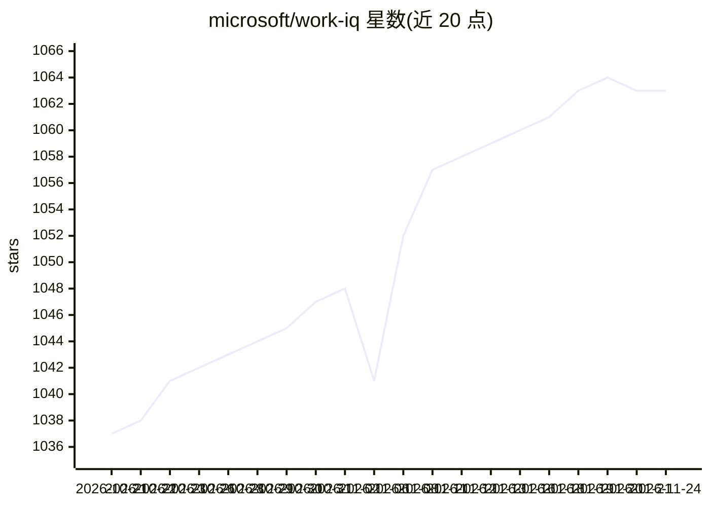

# microsoft/work-iq

⭐ 1,063 · JavaScript · NOASSERTION · 推送 2026-11-20 · [GitHub](https://github.com/microsoft/work-iq) · 组织维护

**让 AI 助手接入 Microsoft 365 数据的 MCP 服务与 CLI**

微软官方的 Work IQ 插件合集，包含 MCP server、skills 和工具，将 GitHub Copilot 等 AI 助手连接到 Microsoft 365 数据。hosted 版插件无需本地 Node.js 运行时；另有独立 CLI（npm 全局安装）可启动 stdio MCP server。查询覆盖邮件、会议、文档、Teams 消息与人员，需租户管理员授予同意，检索可用性依租户而定，处于 Public Preview 阶段。

## 筛选速览

| 维度 | 判定 | 备注 |
|---|---|---|
| AI 角色 | `ai-ecosystem` | LLM/agent 周边工具 |
| 许可风险 | `none` | NOASSERTION |
| 部署形态 | `library` | 以包/库形式分发 |
| 模型依赖 | — | README 未给出锁定关系 |
| 硬件要求 | — | 无带数字的原话,不猜 |
| 安装摩擦 | `low` | 无编译、无系统依赖或容器化 |
| 成熟度 | `idea` | |

## 能力要点

- hosted MCP 插件无需本地 Node.js 运行时
- CLI 提供 ask/mcp/version 命令，支持交互模式与指定 agent 提问
- 支持 win/linux/osx 的 x64 与 arm64 平台
- 包含 productivity 洞察插件（邮件分诊、会议成本、组织架构等只读功能）

## 适用场景

- 让 Copilot 助手回答本周会议安排、总结特定邮件
- 查找最近处理过的文档或 Teams 频道消息
- 以独立 MCP server 形式接入编码 agent 或 IDE

## 场景标签

 · 领域:AI 工具集成/办公数据访问

## 证据(README 行号)

> L3: > The official Microsoft Work IQ plugin collection for GitHub Copilot ✨
> L5: Extend the power of GitHub Copilot with Work IQ plugins — MCP servers, skills, and tools that connect AI assistants 
> L134: |`workiq mcp`|Start MCP stdio server for agent communication|

## 星数曲线

2026-10-21 1,037 → 2026-11-24 1,063（+26）

---
*卡片 v1 · prompt 1.4 · 生成 2026-11-24 · 置信度 high · 依据 README sha `0bf2087f3f3b` · [字段定义](../../DATASET.md)*
