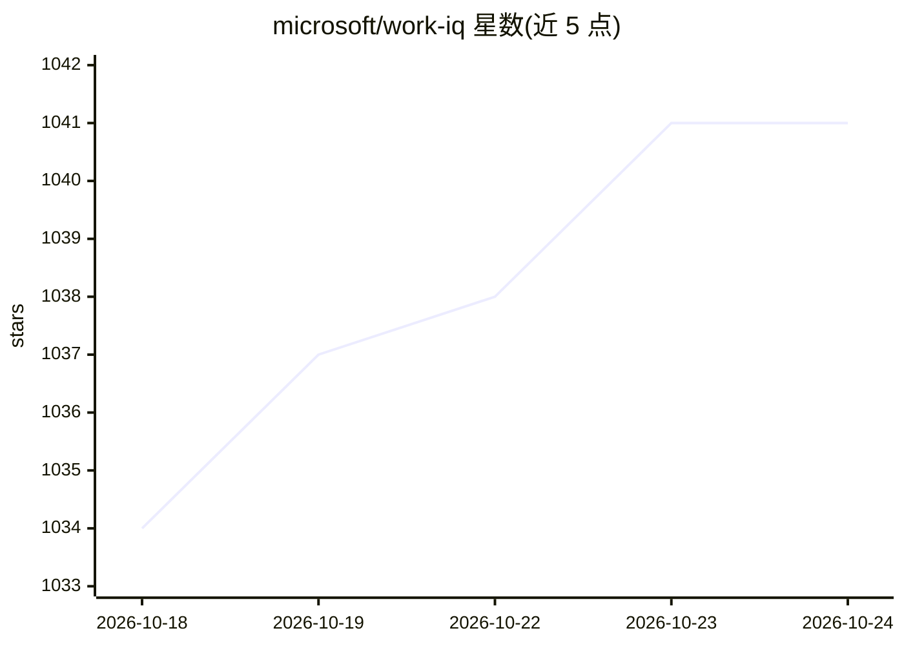

# microsoft/work-iq

⭐ 1,041 · JavaScript · NOASSERTION · 推送 2026-10-23 · [GitHub](https://github.com/microsoft/work-iq) · 组织维护

**连接 AI 助手与 Microsoft 365 数据的 MCP Server 与 CLI 插件集**

微软官方 Work IQ 插件集合，以 MCP Server 和 CLI 形式将 GitHub Copilot 等 AI 助手接入 Microsoft 365 租户数据，支持用自然语言查询邮件、会议、文档、Teams 消息和人员信息。访问租户数据需管理员同意授权，首次访问弹同意对话框。提供 npm 全局安装与 npx 免安装运行两种方式，CLI 含 ask/mcp/version 命令；收录 4 个插件（workiq、workiq-preview、M365 agents toolkit、workiq-productivity）。当前处于 Public Preview 阶段，功能与 API 可能变动。

## 筛选速览

| 维度 | 判定 | 备注 |
|---|---|---|
| AI 角色 | `ai-ecosystem` | LLM/agent 周边工具 |
| 许可风险 | `none` | NOASSERTION |
| 部署形态 | `library` | 以包/库形式分发 |
| 模型依赖 | — | README 未给出锁定关系 |
| 硬件要求 | — | 无带数字的原话,不猜 |
| 安装摩擦 | `low` | 无编译、无系统依赖或容器化 |
| 成熟度 | `idea` | |

## 能力要点

- MCP stdio server（workiq mcp）供 agent 通信
- workiq ask 以自然语言查询 M365 邮件/会议/文档/Teams/人员
- 收录 4 个插件，含声明式 agent 构建评估工具包与生产力洞察
- 支持 win/linux/osx 的 x64 与 arm64 六个平台

## 适用场景

- 在 GitHub Copilot CLI 中直接查询我的会议、邮件和文档
- 以独立 MCP server 形式接入 VS Code 或其他编码 agent
- 构建和评估 M365 Copilot 声明式 agent

## 场景标签

`数据分析` · 领域:效率与自动化

## 证据(README 行号)

> L5: Extend the power of GitHub Copilot with Work IQ plugins — MCP servers, skills, and tools that connect AI assistants 
> L112: |`workiq mcp`|Start MCP stdio server for agent communication|

## 星数曲线

2026-10-18 1,034 → 2026-10-24 1,041（+7）

---
*卡片 v1 · prompt 1.4 · 生成 2026-10-21 · 置信度 high · 依据 README sha `0cd90c01889f` · [字段定义](../../DATASET.md)*
