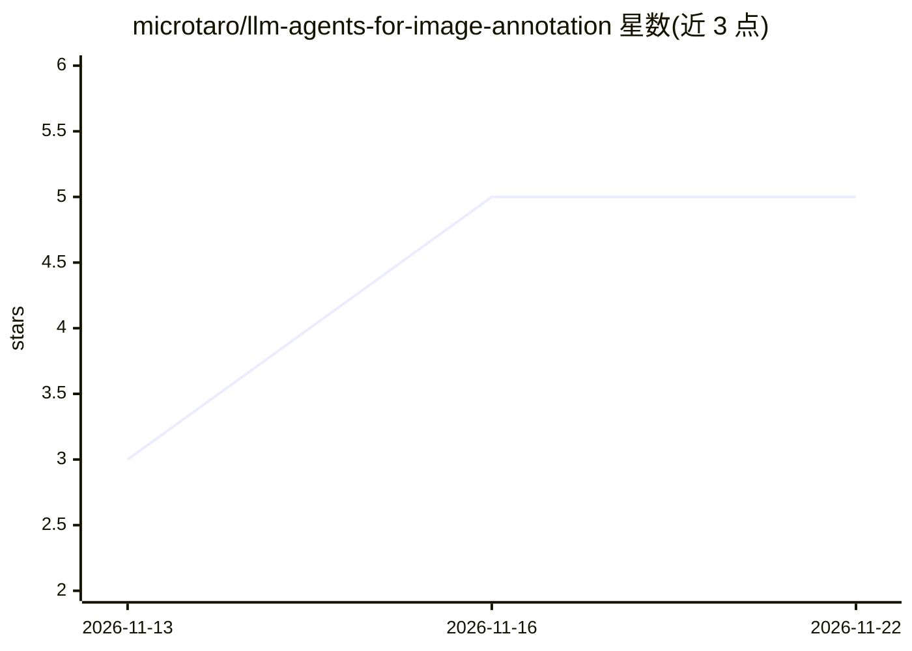

# microtaro/llm-agents-for-image-annotation

⭐ 5 · Python · Apache-2.0 · 推送 2026-11-20 · [GitHub](https://github.com/microtaro/llm-agents-for-image-annotation) · 个人维护

**个人图像标注工具：LLM agent 画框与轮廓并读值，人工审批**

桌面式图像标注应用：用户用一句话描述标注需求，由本机运行的 Claude Code 或 Codex CLI 驱动 agent 对图像生成边界框、分割轮廓与印刷文字读取结果。流程为请求→agent 生成计划→先在少量样本上试标→用户批准后批量运行，所有改动数据的操作以决策卡片形式由人确认，并可手动修正，最终导出 COCO JSON 供训练。界面与 agent 均支持英语和日语。提供 HTTP API 与 MCP 端点供 CLI 直接操作；MCP 端点无审批步骤，仅建议在本机使用。

## 筛选速览

| 维度 | 判定 | 备注 |
|---|---|---|
| AI 角色 | `ai-native` | 本体是模型或模型工具 |
| 许可风险 | `permissive` | Apache-2.0 |
| 部署形态 | `None` |  |
| 模型依赖 | — | README 未给出锁定关系 |
| 硬件要求 | — | 无带数字的原话,不猜 |
| 安装摩擦 | `low` | 无编译、无系统依赖或容器化 |
| 成熟度 | — | 结构信号不足 |

## 能力要点

- 一句话请求生成标注计划，先样本后全量，人工逐项审批
- 支持边界框、分割轮廓、框中框及印刷文字读取，导入导出 COCO JSON
- 通过本机 Claude Code 或 Codex CLI 调用订阅额度，不收集 API key
- 内置 5 个合成图像示例数据集与英文/日文界面

## 适用场景

- 给训练数据生成边界框或实例分割标注
- 读取药品盒、托盘零件等图像中的印刷文字与编号
- 在标注前先看样本结果再决定是否批量运行
- 通过 MCP 让 Claude Code 直接操作标注数据集

## 场景标签

`目标检测` · 领域:感知与多模态

## 证据(README 行号)

> L3:  Say what you want annotated and press a button or two. An LLM looks at your images, zooms in, and draws outlines or
> L46: **2. Plan.** The agent looks through your images and writes the plan. Read it on the right. Nothing runs until you 
> L86: - **You decide.** Agents can draft a plan, but anything that changes your data becomes a decision you accept or dec

## 星数曲线

2026-11-13 3 → 2026-11-22 5（+2）

---
*卡片 v1 · prompt 1.4 · 生成 2026-11-21 · 置信度 high · 依据 README sha `4eafc19bb586` · [字段定义](../../DATASET.md)*
