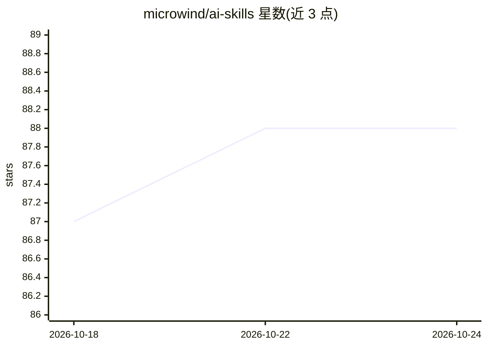

# microwind/ai-skills

⭐ 88 · Python · 推送 2026-06-04 · [GitHub](https://github.com/microwind/ai-skills) · 个人维护 · 中文 README

**面向程序员的中文编程技能知识库，96+ 个 AI 可用 SKILL**

结构化编程知识库，收录 96+ 个按后端、前端、框架、云原生、数据库等 10 类组织的技能，每个技能含 SKILL.md、scripts/ 示例代码、references/ 参考文档。提供三种使用方式：直接当技术手册浏览、把技能文件夹复制到 .claude/skills/ 或 .cursor/skills/ 供 AI 编程助手加载、或手动复制提示词给通用 AI。全中文文档，覆盖 Java/Python/Go/Rust 等语言与主流框架。由个人（Jarry 李春平）维护，附属其 AI 学习系列仓库。

## 筛选速览

| 维度 | 判定 | 备注 |
|---|---|---|
| AI 角色 | `ai-knowledge` | 知识聚合/清单类 |
| 许可风险 | `none` | — |
| 部署形态 | `self-host` | docker 或自建部署 |
| 模型依赖 | — | README 未给出锁定关系 |
| 硬件要求 | — | 无带数字的原话,不猜 |
| 安装摩擦 | `low` | 无编译、无系统依赖或容器化 |
| 成熟度 | — | 结构信号不足 |

## 能力要点

- 96+ 个技能按 10 个类别组织，每个含 SKILL.md 与多语言示例代码
- 技能文件夹可复制到 Claude/Codex/Gemini/Cursor 等工具的 skills 目录
- 每个技能附中文说明与参考文档链接

## 适用场景

- 把编程技能装到 Claude/Cursor 等 AI 助手里提升编程辅助效果
- 作为中文编程知识手册查阅各框架与工具的实践
- 复制 SKILL.md 提示词给通用 AI 获得领域化输出

## 场景标签

`提示工程` · 领域:Agent 开发

## 证据(README 行号)

> L10: 这是一个结构化的编程知识库，包含**100多个**精选的AI-powered Skills，涵盖：
> L36: **场景二：给 AI 编程助手装上技能（推荐）**

## 星数曲线

2026-10-18 87 → 2026-10-24 88（+1）

---
*卡片 v1 · prompt 1.4 · 生成 2026-10-23 · 置信度 mid · 依据 README sha `303e0d865799` · [字段定义](../../DATASET.md)*
