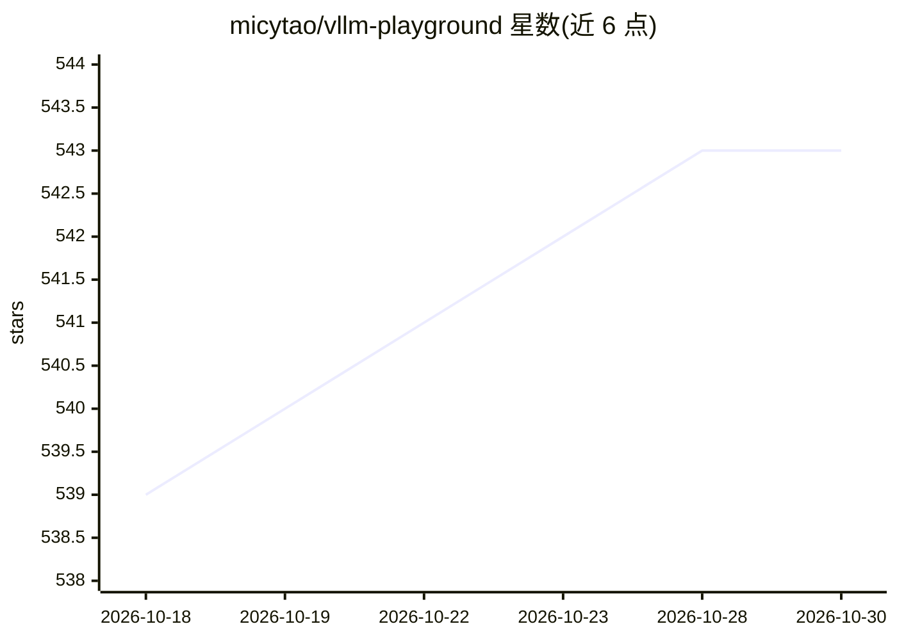

# micytao/vllm-playground

⭐ 543 · JavaScript · Apache-2.0 · 推送 2026-10-16 · [GitHub](https://github.com/micytao/vllm-playground) · [官网](https://micytao.github.io/vllm-workshop/) · 个人维护

**vLLM 服务器的 Web 管理与交互界面**

面向 vLLM 推理服务器的 Web 前端：通过浏览器启动并管理 subprocess、容器或远程 vLLM 实例，提供多实例切换、Markdown 流式聊天、VLM 视觉对话、工具调用、结构化输出、MCP 工具接入与 Claude Code 后端配置。支持 GPU 与 CPU 模式，macOS Apple Silicon 有 CPU 与 Metal 加速路径，企业侧提供 OpenShift/K8s 部署脚本与动态 Pod 创建。以 pip 包、源码或容器方式安装，含 GuideLLM 基准测试集成。

## 筛选速览

| 维度 | 判定 | 备注 |
|---|---|---|
| AI 角色 | `ai-ecosystem` | LLM/agent 周边工具 |
| 许可风险 | `permissive` | Apache-2.0 |
| 部署形态 | `library` | 以包/库形式分发 |
| 模型依赖 | local-ok | 支持本地模型 |
| 硬件要求 | — | 无带数字的原话,不猜 |
| 安装摩擦 | `low` | 无编译、无系统依赖或容器化 |
| 成熟度 | `idea` | |

## 能力要点

- 多实例管理：subprocess、容器、远程 vLLM 后端并排运行与切换
- VLM 视觉对话、工具调用、JSON Schema/Regex/Grammar 结构化输出
- MCP 工具接入（人工审批环节）与 Claude Code 后端配置
- OpenShift/K8s 部署脚本与动态 Pod 创建

## 适用场景

- 在本地或服务器上通过网页启动和管理 vLLM 推理服务
- 用开源模型作为 Claude Code 的私有后端
- 在 OpenShift/K8s 环境部署企业级 vLLM 服务

## 场景标签

`推理引擎` · 领域:训练与推理

## 证据(README 行号)

> L3: A modern web interface for managing and interacting with vLLM servers (www.github.com/vllm-project/vllm). Supports G
> L27: Run subprocess, container, and remote vLLM servers side by side; switch tabs, save configs, and manage everything f
> L78: |☸️ **OpenShift/K8s**|Enterprise deployment with dynamic pod creation|

## 星数曲线

2026-10-18 539 → 2026-10-30 543（+4）

---
*卡片 v1 · prompt 1.4 · 生成 2026-10-21 · 置信度 high · 依据 README sha `0970f6548357` · [字段定义](../../DATASET.md)*
